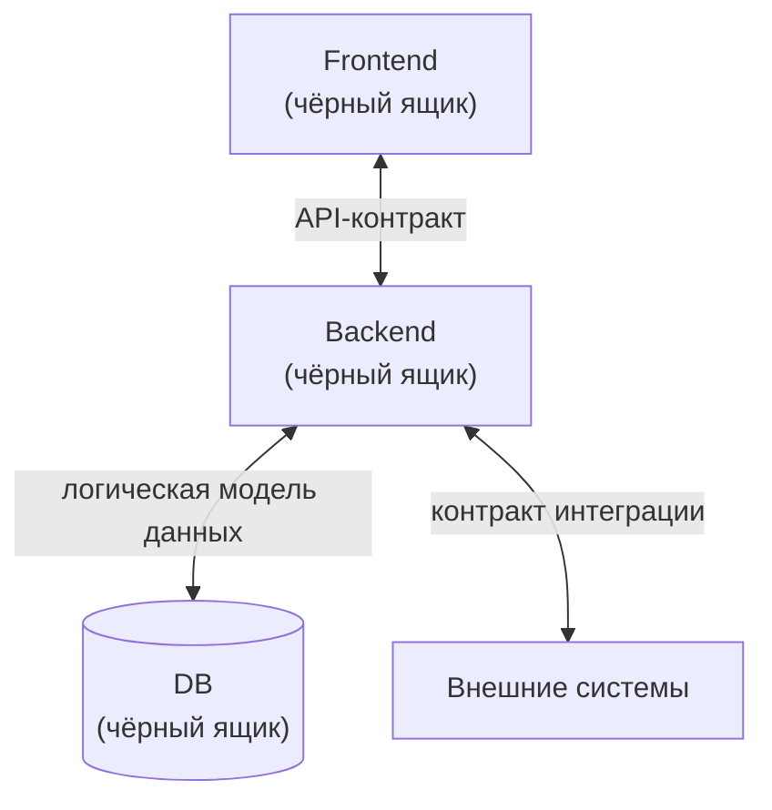

# 01. Принципы и роли

## Принцип чёрного ящика

Для аналитика frontend, backend и база данных — чёрные ящики. Он знает, **что они принимают и отдают**, но не знает, **как они устроены внутри**.

Аналитик описывает **стрелки** (взаимодействие), разработчик отвечает за **содержимое блоков** (реализацию).

### Что пишет аналитик и что не пишет

| Пишет | Не пишет |
|---|---|
| ФТ фичи: идея, основной механизм, сценарии | классы, пакеты, компоненты, хуки |
| изменения API-контрактов (OpenAPI) | выбор СУБД, SQL под конкретную СУБД |
| изменения модели данных в общем виде (сущности, поля, связи, индексы) | кэш, очереди, внутренние сервисы |
| изменения интерфейса: экраны, состояния, поведение | вёрстку и устройство компонентов |
| взаимодействие с внешними системами | как именно реализовано это взаимодействие |

## Две спецификации

| | Store | Master spec кодового репозитория |
|---|---|---|
| Кто ведёт | системные аналитики | разработчики своей части |
| Вопрос | что и как взаимодействует | как реализовано и как ведёт себя эта часть |
| Содержание | подробные ФТ, контракты, взаимодействие, интеграции | техническая реализация и общее поведение части |
| Где лежит | общий репозиторий Store | `openspec/specs/` в репозитории сервиса |

Эти спецификации не дублируют друг друга: первая описывает ожидания снаружи, вторая устройство внутри.

## Роли

### Системный аналитик

- Описывает фичи в Store по бизнес-требованиям (БТ), работает через Gigacode в формате brainstorm.
- Ведёт `FRD.md`, `BFRD.md`, `FFRD.md` и `contracts/`.
- Проходит ревью вместе с коллегой-аналитиком и представителями затронутых частей.
- Ставит тег релиза Store `x.y.z` на feature freeze и архивирует фичи.
- Сообщает разработчикам об изменениях ФТ комментарием в Jira.

### Разработчик (backend или frontend)

- Подключает Store как submodule и пинит его на нужный тег.
- Создаёт локальные changes, декомпозируя фичу по своему усмотрению.
- Реализует свою часть по локальной схеме (superpowers-bridge) вместе с Gigacode.
- Ведёт локальный master spec и архивирует change до мержа PR.
- Исправляет ошибки реализации без изменений в Store, привязав работу к Jira.
- Сообщает об ошибках в ФТ через Jira-баг.

## Сквозные принципы

1. **Один источник правды по ФТ.** Требования лежат только в Store, в кодовых репозиториях на них ссылаются, а не копируют.
2. **Версия вместо копии.** Разработчик пинит Store на тег, а не копирует файлы.
3. **Минимальный контекст.** Файлы разделены по областям, чтобы агент не читал лишнее.
4. **Детерминированное там, где можно.** Контракты проверяются автоматически, остальное остаётся на разработчиках и ревью.
5. **Простота для аналитиков.** Работа с git сведена к PR и одной ручной операции (тег релиза).

Следующий шаг: [[02-Store]].
