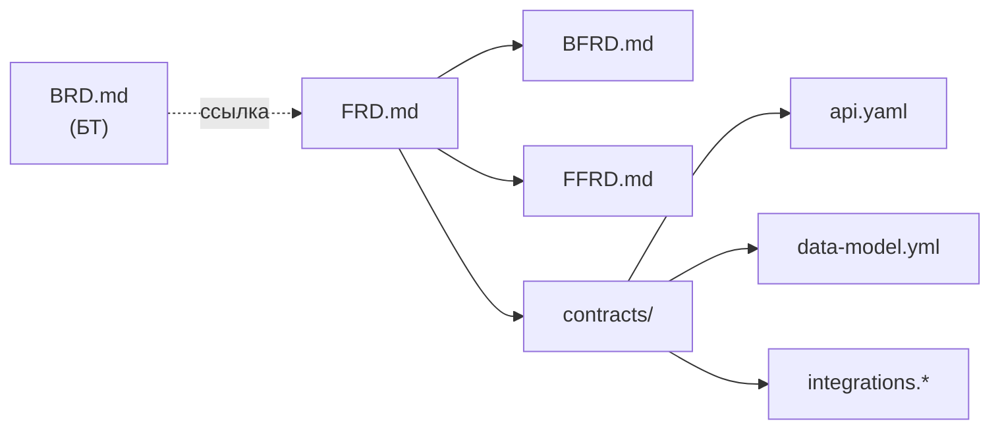
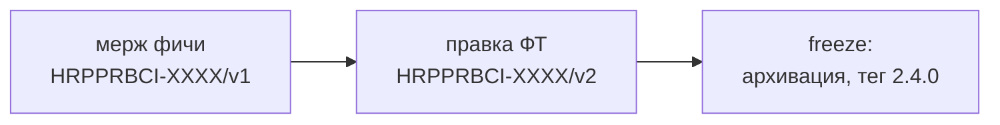

# 02. Store

**Store** — общий репозиторий в Bitbucket, где аналитики ведут функциональные требования. Один Store на всю систему, кодовые репозитории подключают его как git submodule.

## Структура репозитория

```
store/
├── docs/                        инструкции: принципы, встраивание, матрицы чтения
├── business-requirements/       БТ, скопированные из Confluence (BRD-*.md)
├── changes/                     фичи в работе
│   ├── HRPPRBCI-XXXX-суффикс/   одна папка на фичу
│   └── archive/                 архив завершённых фич
└── specs/                       актуальное описание системы по модулям
    └── <модуль>/
```

Папка `changes/` — то, что согласовано, но ещё не реализовано. Папка `specs/` — то, что реализовано и вошло в релиз.

## Структура одной фичи

```
changes/HRPPRBCI-XXXX-суффикс/
├── FRD.md          единое ФТ фичи: таблица, идея, механизм, ссылки на BFRD и FFRD
├── BFRD.md         изменения для backend (если затрагивается)
├── FFRD.md         изменения для frontend, включая интерфейс (если затрагивается)
└── contracts/      все не-md файлы
    ├── api.yaml
    ├── data-model.yml
    └── integrations.*
```

Правило: **нет области, нет файла.** Если фича не затрагивает frontend, файла `FFRD.md` нет. Если нет внешних интеграций, нет и `integrations.*`.



### Файлы и форматы

| Файл | Формат | Содержание | Читают |
|---|---|---|---|
| `FRD.md` | Markdown | таблица с основной информацией, идея и основной механизм без деталей реализации, ссылки на `BFRD.md`, `FFRD.md` | все |
| `BFRD.md` | Markdown | требования и поведение, относящиеся к backend | backend |
| `FFRD.md` | Markdown | требования, экраны, состояния, поведение интерфейса | frontend |
| `contracts/api.yaml` | OpenAPI (YAML) | фрагмент контракта: что добавляется или меняется | backend, frontend |
| `contracts/data-model.yml` | YAML | дельта логической модели данных | backend |
| `contracts/integrations.*` | OpenAPI/AsyncAPI и др. | контракты внешних систем | backend |

Это набор по умолчанию. Агент разработчика читает его по матрице чтения (см. [[06-Работа-с-Gigacode]]).

### Таблица в начале `FRD.md`

Отдельного файла паспорта фичи нет: короткое определение фичи — таблица в начале `FRD.md`.

| Поле | Пример |
|---|---|
| Jira | HRPPRBCI-XXXX |
| Название | Фильтры в списке заявок |
| Тип | feature или fix |
| БТ | ссылка на `business-requirements/BRD-….md` |
| Модули | requests |
| Части | backend, frontend |
| Impact | minor (major, minor или patch) |

Поле `Impact` определяет повышение версии релиза Store (см. ниже). Жёсткий шаблон `FRD.md` будет добавлен по результатам практики: единообразие нужно, но шаблон лучше строить на реальных фичах.

### Формат `api.yaml`: фрагмент OpenAPI

Файл содержит только добавленные и изменённые пути и схемы. Изменённая операция описывается **целиком**. Удаляемое перечисляется в поле `x-removed`.

```yaml
openapi: 3.0.3
info:
  title: Requests API (фрагмент фичи HRPPRBCI-XXXX)
  version: fragment
x-removed:
  - path: /requests/legacy-search
    method: get
paths:
  /requests:
    get:
      summary: Список заявок с фильтрами
      # ... операция описана целиком
```

Для работы агента и codegen разработчик получает **полный** контракт: `specs/` на пинованном теге плюс фрагмент своей фичи.

### Формат `data-model.yml`: дельта логической модели

Описывается в общем виде, без привязки к СУБД: сущности, поля, типы, связи, ограничения, индексы. Дельта группируется по сущностям и действиям `added`, `modified`, `removed`.

```yaml
entities:
  Request:
    added:
      indexes:
        - fields: [status, createdAt]
          reason: фильтрация по статусу и периоду
    modified: {}
    removed: {}
```

Разработчик сам пишет миграцию под свою СУБД.

## Master spec по модулям

`specs/` организован по модулям системы (например, `requests`, `users`). Структура модуля повторяет структуру фичи:

```
specs/requests/
├── FRD.md
├── BFRD.md
├── FFRD.md
└── contracts/
    ├── api.yaml          полный актуальный контракт модуля
    └── data-model.yml    полная актуальная модель модуля
```

Список модулей определяет команда при внедрении (см. [[07-Внедрение]]). В таблице `FRD.md` фича указывает, какие модули затрагивает.

## Архивация: скрипт `store-archive`

Штатная команда `openspec archive` вливает в master spec только текстовые дельты из `specs/<модуль>/spec.md`. Остальные файлы изменения она просто переносит в архив. Поэтому в Store есть скрипт-обёртка `store-archive`. Он делает два действия:

1. вызывает `openspec archive --skip-specs` (папка фичи уходит в `changes/archive/`);
2. вливает файлы фичи в `specs/<модуль>/` по детерминированным правилам.

| Файл | Правило вливания |
|---|---|
| `contracts/api.yaml` | по ключу «путь + метод» и имени схемы: новое добавляется, изменённое заменяется целиком, перечисленное в `x-removed` удаляется |
| `contracts/data-model.yml` | по имени сущности и поля или индекса: `added`, `modified`, `removed` |
| `contracts/integrations.*` | так же, как `api.yaml` |
| `FRD.md`, `BFRD.md`, `FFRD.md` | по разделам, которые помечены как добавленные, изменённые или удалённые |

Точный формат разделов текстовых файлов входит в жёсткий шаблон ФТ и уточняется по практике.

## Ветки и ревью

| Ветка | Назначение |
|---|---|
| `master` | согласованное состояние Store |
| `feature/HRPPRBCI-XXXX` | новая фича |
| `fix/HRPPRBCI-YYYY` | исправление ошибки в ФТ |
| `release/x.y.z` | архивация фич релиза на feature freeze |

Ветки короткоживущие: из `master`, через PR обратно в `master`.

**Ревью PR** обязательно проходит с участием коллеги-аналитика и по одного представителя каждой затронутой части (backend и/или frontend, по таблице `FRD.md`). Разработчики видят контракты до начала работы и находят нереализуемое.

## Версионирование и теги

В Store два вида тегов с разным смыслом.

| | Тег фичи | Тег релиза Store |
|---|---|---|
| Формат | `HRPPRBCI-XXXX/vN` | `x.y.z` (SemVer) |
| Когда | при каждом мерже PR, затрагивающего фичу | при архивации на feature freeze |
| Кто ставит | Jenkins автоматически | аналитик вручную |
| Что фиксирует | согласованное состояние фичи | состояние Store с реализованными фичами релиза |
| Для чего | разработчик пинит submodule во время работы | разработчик пинит submodule после архивации |

### Тег фичи

Jenkins по вебхуку Bitbucket при мерже в `master`:

1. берёт Jira ID из имени ветки (`feature/HRPPRBCI-XXXX` или `fix/HRPPRBCI-XXXX`);
2. находит существующие теги этой фичи и вычисляет следующий номер;
3. ставит тег на коммит мержа в `master`.

Первый мерж даёт `HRPPRBCI-XXXX/v1`, правки после согласования дают `v2`, `v3` и так далее.

### Тег релиза Store

Аналитик ставит его вручную после мержа PR из ветки `release/x.y.z`, в интерфейсе Bitbucket. Тег ставится на коммит в `master`, а не на коммит ветки (при squash-мерже это разные коммиты).

| Часть | Когда повышается |
|---|---|
| MAJOR | несовместимое изменение контракта: удалён или изменён эндпоинт или поле так, что старый клиент ломается |
| MINOR | новая фича: добавления, совместимые с прежним |
| PATCH | уточнение или исправление уже архивированной спецификации без новой функциональности |

Версия релиза определяется по **максимальному** `Impact` среди включённых в него фич.



### Версии Store и приложений независимы

Версия Store не соотносится с версиями backend и frontend: один релиз Store касается нескольких сервисов, а версия сервиса меняется и без изменений в Store (рефакторинг, исправление реализации). Связь односторонняя: сборка сервиса фиксирует, на какую версию Store она опирается (пин submodule), и эта версия попадает в метаданные сборки и релизные заметки сервиса.

## Бизнес-требования

БТ ведутся в Confluence. Пока они **дублируются** в папку `business-requirements/` Store (`BRD-….md`), и каждая фича обязана ссылаться на свои БТ в таблице `FRD.md`. Файл БТ — источник для аналитика и его агента. Разработчик может прочитать БТ, если это нужно, но по умолчанию агент разработчика их не читает.

## Схема OpenSpec для Store

В Store используется собственная схема OpenSpec с набором артефактов, который описан выше. Она не содержит артефактов реализации (`design`, `plan`, `verify` и других): это зона разработчиков. Инструкции в схеме задают агенту аналитика, **что писать в каждом файле и чего не писать** (см. [[06-Работа-с-Gigacode]]).

## Инструкции внутри Store

В `docs/` лежат инструкции по принципам работы со Store, по встраиванию Store в кодовые репозитории и матрицы чтения для backend и frontend. Пример смотрите в [примере](example/README.md).

Следующий шаг: [[03-Кодовые-репозитории]].
