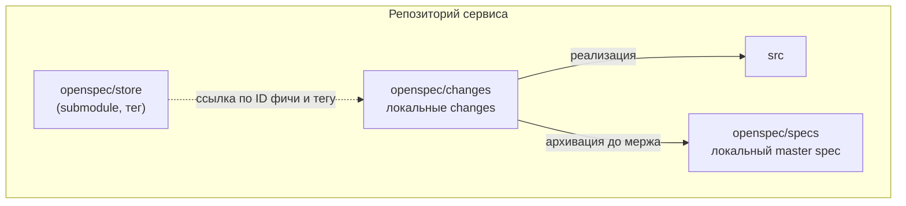
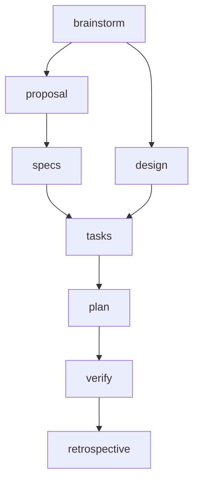
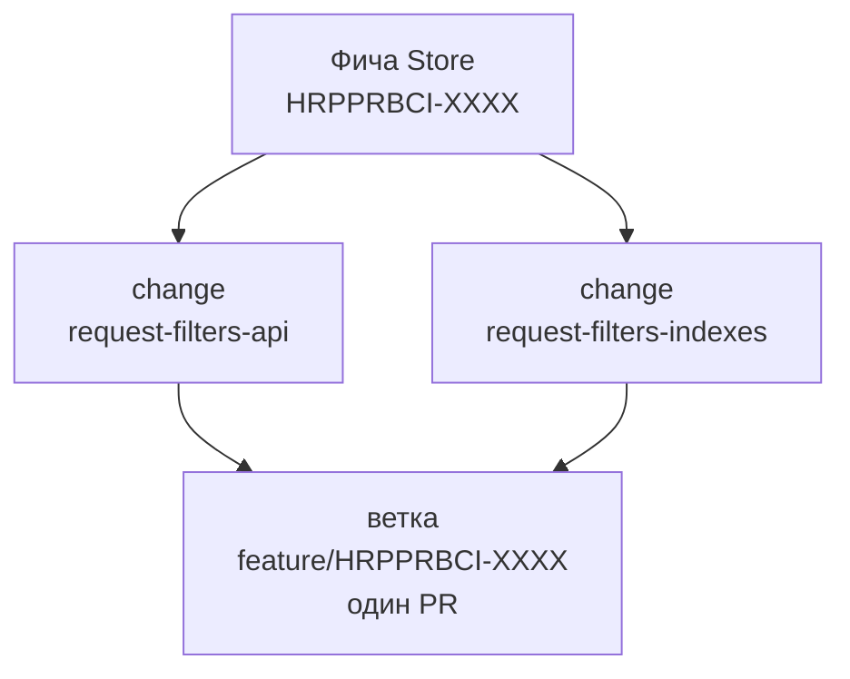
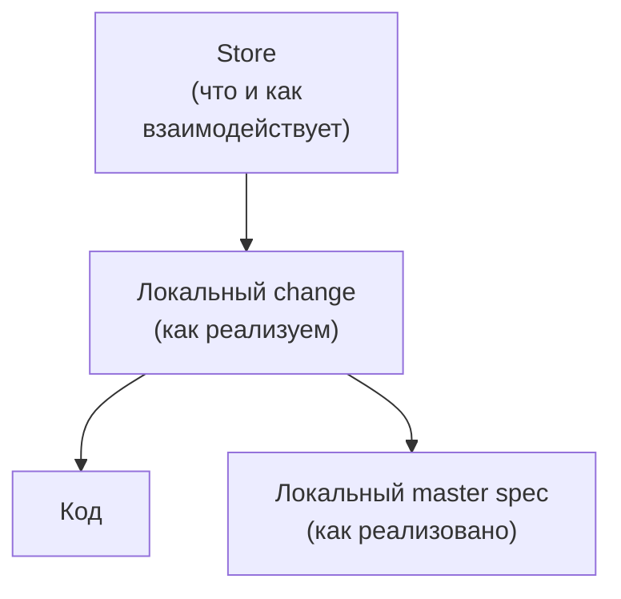

# 03. Кодовые репозитории

В каждом репозитории сервиса (backend, frontend) есть свой OpenSpec: подключённый Store, локальная схема, локальный master spec и локальные changes.

## Структура репозитория

```
backend-service/
├── openspec/
│   ├── store/                 git submodule: Store, пин на тег
│   ├── schemas/
│   │   └── sber-backend/      локальная схема (форк superpowers-bridge)
│   ├── specs/                 локальный master spec: реализация и поведение этой части
│   │   └── <модуль>/spec.md
│   └── changes/
│       ├── <суффикс-change>/  артефакты одного change
│       └── archive/           архив завершённых changes
├── hooks/                     pre-push хук (подключается при сборке)
├── Jenkinsfile
└── src/...
```

Frontend устроен так же, различаются схема (`sber-frontend`) и содержимое.



## Подключение Store как submodule

Store физически лежит внутри проекта, а не где-то на машине разработчика.

```bash
# один раз: подключить Store
git submodule add <адрес-репозитория-store-в-bitbucket> openspec/store

# закрепить на теге фичи (во время работы)
git -C openspec/store checkout HRPPRBCI-XXXX/v1
git add openspec/store
git commit -m "HRPPRBCI-XXXX: пин Store на HRPPRBCI-XXXX/v1"

# после архивации: перейти на тег релиза Store
git -C openspec/store checkout 2.4.0
git add openspec/store
git commit -m "HRPPRBCI-XXXX: пин Store на 2.4.0"

# при клонировании сервиса
git clone <адрес-сервиса> && git submodule update --init
```

Submodule **всегда пинится на тег**, не на коммит и не на ветку. Подключением и командами git занимается разработчик, аналитик с этим не сталкивается.

## Локальная схема

За основу берётся схема **superpowers-bridge** из репозитория `JiangWay/openspec-schemas`. Её копия (форк) хранится в `openspec/schemas/` репозитория.



| Артефакт | Назначение |
|---|---|
| `brainstorm.md` | сырые результаты обсуждения подхода с агентом |
| `proposal.md` | что и зачем делаем в этом сервисе, метаданные change |
| `design.md` | технические решения: контекст, цели, риски, миграция |
| `specs/` | дельта локального master spec: добавляемое и меняемое поведение |
| `tasks.md` | чеклист задач реализации |
| `plan.md` | план из микрозадач |
| `verify.md` | результаты проверок (см. [[05-Проверки-и-сборка]]) |
| `retrospective.md` | итоги по завершённому change |

Стандарт можно менять под нужды команды: набор артефактов у backend и frontend может различаться, и это не регламентируется. Единственное, что схемы дополняют ссылкой на Store: шаги `brainstorm` и `design` содержат указание прочитать инструкцию своей части в `openspec/store/docs/` (подробнее в [[06-Работа-с-Gigacode]]).

Схема требует плагин Superpowers и платформу с поддержкой субагентов. Gigacode их поддерживает.

## Метаданные локального change

В начале `proposal.md` каждого change есть блок метаданных:

```yaml
---
jira-id: HRPPRBCI-XXXX
store-feature: HRPPRBCI-XXXX
store-version: HRPPRBCI-XXXX/v1
---
```

| Поле | Обязательно | Смысл |
|---|---|---|
| `jira-id` | всегда | задача, под которую делается работа |
| `store-feature` | если есть фича в Store | идентификатор фичи Store |
| `store-version` | если есть фича в Store | тег Store, на который пинован submodule |

Ссылка на Store указывает на **фичу в конкретной версии**, а не на путь к её папке. Путь после архивации меняется (из `changes/` в `specs/`), поэтому агент и скрипты вычисляют его по идентификатору и версии.

### Change без фичи в Store

Технический рефакторинг или исправление ошибки реализации (когда ФТ были верны, а код написан неверно) делается без фичи в Store. Тогда поля `store-feature` и `store-version` отсутствуют, а `jira-id` остаётся обязательным.

## Именование

| Что | Правило | Пример |
|---|---|---|
| Папка change | читаемый суффикс, без Jira ID | `request-filters-api` |
| Ветка | gitflow: `feature/`, `fix/` и Jira ID | `feature/HRPPRBCI-XXXX` |
| Ветка исправления | `fix/` и Jira ID | `fix/HRPPRBCI-ZZZZ` |

Папки changes названы без Jira ID, потому что одну фичу из Store разработчик может декомпозировать на несколько changes без отдельных Jira-задач.

## Декомпозиция фичи на changes

Декомпозиция нужна, чтобы сузить контекст агента и реализовывать фичу поэтапно.



- Несколько changes одной Jira-задачи делаются **в одной ветке** и идут одним PR. У всех changes одинаковый `jira-id`.
- Если декомпозиция сделана на уровне Jira (отдельные задачи), у каждой задачи своя ветка и свой `jira-id`. `store-feature` у всех один и тот же.

## Локальный master spec и архивация

Локальный master spec (`openspec/specs/`) описывает техническую реализацию и общее поведение своей части. Когда change завершён и проверен (`verify`), разработчик архивирует его **в той же ветке до мержа PR**. Если changes несколько, каждый архивируется сразу после завершения, чтобы следующий видел актуальный master spec.

Благодаря этому код и спецификация в `master` всегда согласованы.

## Что получается в итоге



Следующий шаг: [[04-Жизненный-цикл-фичи]].
