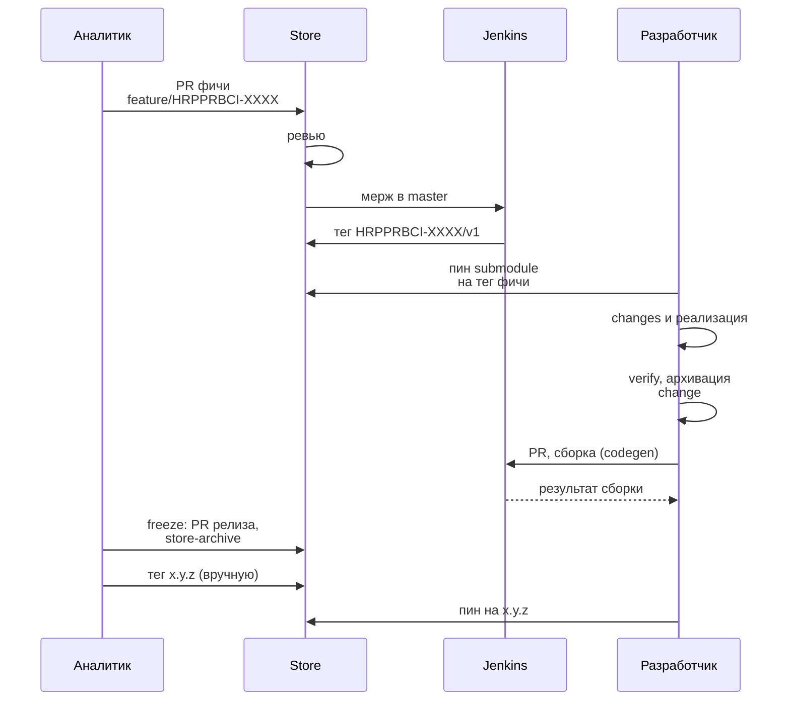
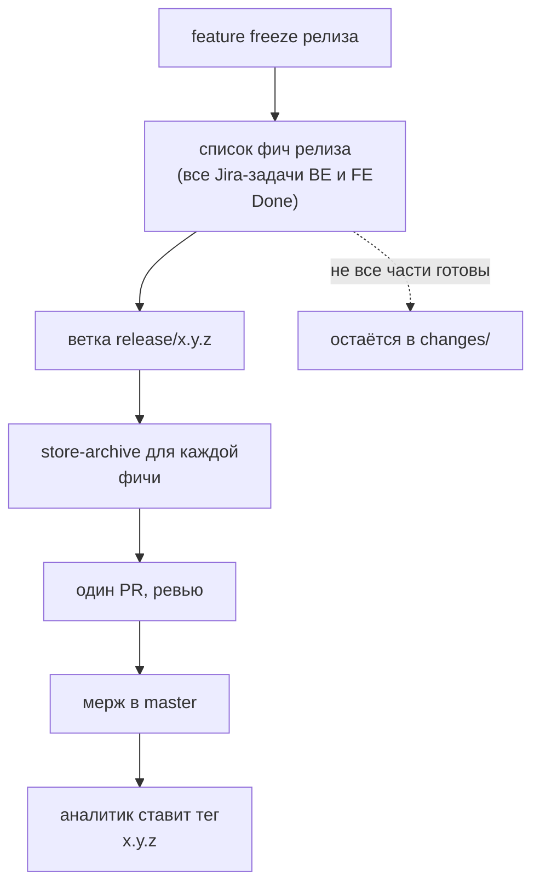
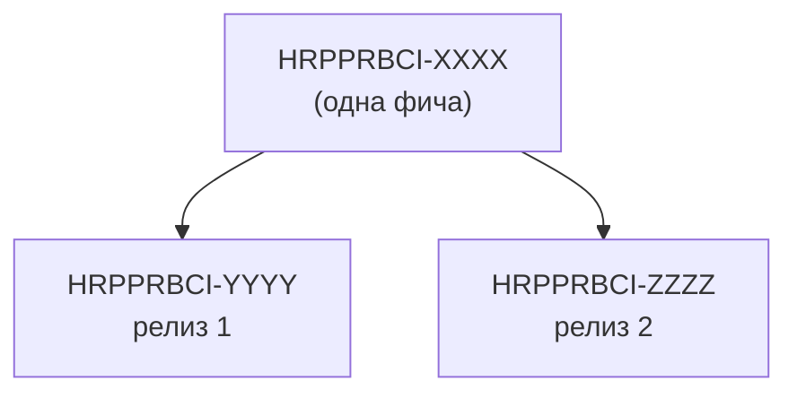

# 04. Жизненный цикл фичи

Основной путь фичи и граничные случаи. Для каждого случая указано, кто что делает.

## Основной путь

### Шаги

| № | Шаг | Кто | Результат |
|---|---|---|---|
| 1 | БТ копируются из Confluence в `business-requirements/` | аналитик | `BRD-….md` |
| 2 | brainstorm с Gigacode: контекст из master spec Store, архива, БТ | аналитик | черновик фичи |
| 3 | ветка `feature/HRPPRBCI-XXXX`, файлы фичи, PR | аналитик | PR в Store |
| 4 | ревью: коллега-аналитик и представители частей | аналитик, разработчики | согласованное ФТ |
| 5 | мерж в `master`, Jenkins ставит тег фичи | Jenkins | `HRPPRBCI-XXXX/v1` |
| 6 | submodule пинится на тег, создаются локальные changes | разработчик | changes с метаданными |
| 7 | реализация по схеме superpowers-bridge | разработчик + Gigacode | код, тесты, `verify.md` |
| 8 | архивация change в локальный master spec | разработчик | обновлённый `openspec/specs/` |
| 9 | PR, сборка с codegen, ревью | разработчик, Jenkins | мерж в `master` сервиса |
| 10 | на feature freeze: архивация фич и тег релиза | аналитик | `x.y.z` |

## Граничные случаи

### 1. ФТ изменилось, когда разработка уже идёт

1. Аналитик вносит правку через PR (ветка `feature/HRPPRBCI-XXXX` или `fix/…`), после мержа Jenkins ставит `HRPPRBCI-XXXX/v2`.
2. Аналитик пишет комментарий в Jira-задаче фичи: новый тег и что изменилось (вручную, автоматического уведомления нет).
3. Разработчик сам решает, когда перейти: пинит submodule на `v2` и обновляет `store-version` в затронутых changes.
4. Агент сравнивает папку фичи между тегами `v1` и `v2` (`git diff` между тегами) и вносит правки в артефакты change и код.
5. Если часть реализации уже смержена, правки оформляются новым change под тем же `store-feature`.

### 2. Ошибка в ФТ (в самом Store)

Сначала аналитик и разработчик вместе решают в комментариях Jira-бага, где ошибка: в коде или в ФТ.

- **Ошибка в коде, ФТ верно.** Исправляется в кодовом репозитории отдельной Jira-задачей, change без `store-feature`. Store не меняется.
- **Ошибка в ФТ.** Процесс как у фичи, но короче: Jira-баг (`HRPPRBCI-YYYY`), ветка `fix/HRPPRBCI-YYYY`, короткий `FRD.md` с типом `fix` и `Impact: patch`, ревью, мерж, тег `HRPPRBCI-YYYY/v1`, архивация на ближайшем freeze. Разработчик, которому исправление нужно срочно, пинится на тег фичи.

### 3. Feature freeze и релиз Store

- В релиз архивируются фичи, у которых **все связанные Jira-задачи разработки (backend и frontend) закрыты в этом релизе**.
- Если реализована только одна часть, фича остаётся в `changes/` целиком и ждёт следующего релиза. Так master spec никогда не описывает то, что реализовано наполовину.
- Версия определяется по максимальному `Impact` среди архивируемых фич.
- Разработчики переходят на тег релиза при ближайшей работе.

### 4. Фичу решили разделить на разные релизы

Фича уже в `changes/`, и принято решение выпустить её частями в разных релизах.

1. Аналитик создаёт для каждой части новую фичу со своим Jira ID. В таблице `FRD.md` указано поле «Выделена из: HRPPRBCI-XXXX».
2. Исходная папка удаляется из `changes/` (история остаётся в git и тегах).
3. Каждая новая фича идёт по общему процессу: свои PR, ревью, теги, критерий архивации.
4. Аналитик сообщает разработчикам комментарием в Jira. Разработчики пинят submodule на теги новых фич и меняют `store-feature` в затронутых changes.

### 5. Баг реализации или рефакторинг без изменений в Store

Разработчик заводит Jira-задачу, делает change **без** `store-feature` и `store-version`, но с обязательным `jira-id`. Ветка `fix/HRPPRBCI-ZZZZ`. Store не затрагивается.

## Сводка: кто и когда ставит теги

| Событие | Тег | Кто |
|---|---|---|
| мерж PR фичи или исправления в Store | `HRPPRBCI-XXXX/vN` | Jenkins |
| мерж PR релиза `release/x.y.z` | `x.y.z` | аналитик |

Следующий шаг: [[05-Проверки-и-сборка]].
