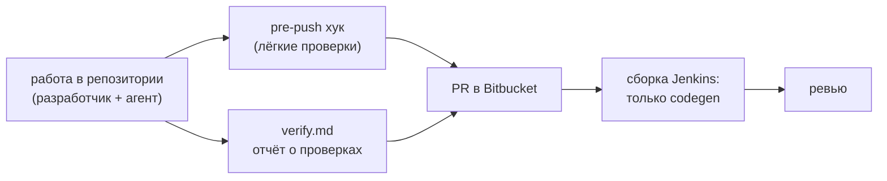
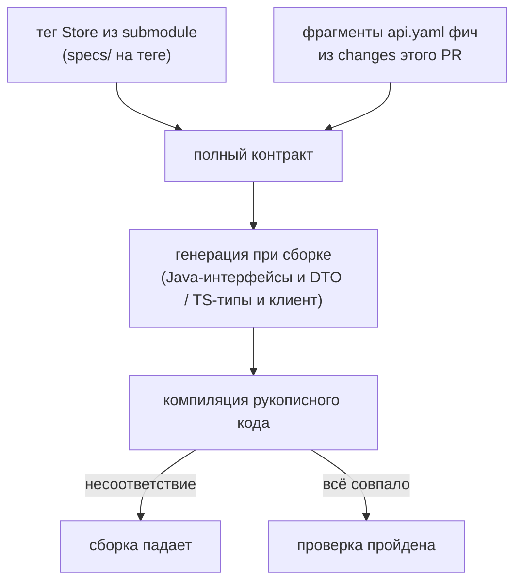

# 05. Проверки и сборка

Принцип: **проверяем жёстко только то, что можно проверить механически**, то есть контракт взаимодействия. Всё остальное это зона ответственности разработчиков и их реализации (концепция чёрного ящика).

## Где что проверяется

| Что | Где | Строгость |
|---|---|---|
| Соответствие кода API-контракту Store | сборка в Bitbucket (Jenkins), шаг codegen | блокирует PR |
| Формальные признаки change | pre-push хук | блокирует push при ошибке |
| Незавершённое оформление change | pre-push хук | предупреждает |
| Сравнение опубликованного контракта сервиса с контрактом Store | в репозитории, в ходе работы | фиксируется в `verify.md` |
| Модель данных, поведение, интерфейс, интеграции | разработчик и ревью | формальных проверок нет |

## Проверки в репозитории

Скрипты проверок лежат в самом кодовом репозитории и версионируются вместе с кодом. Разработчик и агент запускают их локально до PR. Результаты записываются в `verify.md` и прикладываются к PR. В чек-лист PR входит пункт «отчёт `verify.md` приложен», ревьюер решает, достаточно ли отчёта.

Пример содержимого отчёта:

| Проверка | Результат |
|---|---|
| есть `jira-id`, ветка соответствует формату | да |
| submodule пинован на `HRPPRBCI-XXXX/v1`, совпадает с `store-version` | да |
| все задачи в `tasks.md` закрыты | да |
| change архивирован в локальный master spec | да |
| опубликованный контракт сервиса совпадает с контрактом Store | да |

## Pre-push хук

Хук запускает лёгкие версии основных проверок и даёт быструю обратную связь.

| Проверка | Реакция |
|---|---|
| имя ветки соответствует `feature/HRPPRBCI-XXXX` или `fix/HRPPRBCI-XXXX` | блокирует |
| в каждом локальном change есть `jira-id` | блокирует |
| при наличии `store-feature` submodule пинован на существующий тег, `store-version` совпадает | блокирует |
| для change с закрытыми задачами в `tasks.md` есть `verify.md` | предупреждает |
| завершённый change не архивирован | предупреждает |

Пуш незавершённой работы (промежуточные коммиты, обмен веткой) должен проходить, поэтому два последних пункта только предупреждают. Хук можно обойти (`--no-verify`): он даёт обратную связь, а не гарантию. Фактом проверки служит `verify.md` и ревью.

Скрипты хуков лежат в репозитории (`hooks/`) и подключаются автоматически при первой сборке настройкой `core.hooksPath` из сборочной системы. Разработчик ничего не ставит вручную.

## Сборка в Bitbucket: только codegen

Единственная проверка соответствия в сборке: код соответствует контракту взаимодействия из Store.

1. Сборка получает **полный контракт**: актуальный контракт из `specs/` на пинованном теге плюс фрагменты `api.yaml` тех фич, на которые ссылаются changes этого PR (`store-feature`). Чужие фичи в работе в контракт не попадают.
2. Из полного контракта **при каждой сборке** генерируется код: для backend Java-интерфейсы и DTO, для frontend TypeScript-типы и клиент. Сгенерированный код **не коммитится**.
3. Backend реализует сгенерированные интерфейсы, frontend использует сгенерированные типы. Если код не соответствует контракту, сборка падает.

Ограничение: сборка ловит только то, что отражено в сгенерированных интерфейсах. Если backend публикует лишний эндпоинт, которого нет в контракте, это ловит локальная проверка сравнения опубликованного контракта с Store (она запускается в репозитории и фиксируется в `verify.md`).

## Автоматика Jenkins в Store

Отдельно от сборки кодовых репозиториев Jenkins выполняет в Store одну задачу: ставит **тег фичи** `HRPPRBCI-XXXX/vN` при мерже PR в `master`. Алгоритм описан в [[02-Store]].

## Что намеренно не проверяется

| Область | Почему |
|---|---|
| модель данных | логическая модель не привязана к СУБД, соответствие оценивает разработчик |
| поведение, сценарии | интерпретация, а не механическая сверка |
| интерфейс | то же самое |
| внутренняя реализация | это чёрный ящик для аналитика и Store |

Следующий шаг: [[06-Работа-с-Gigacode]].
