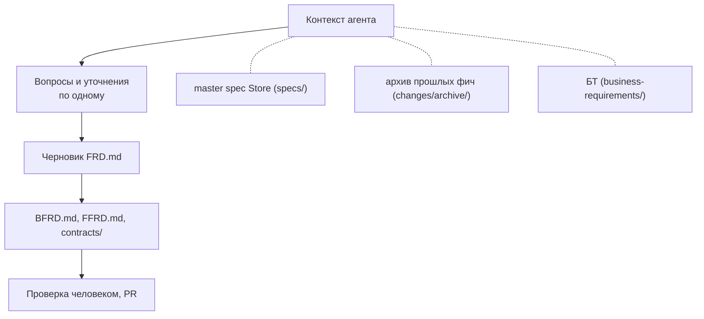
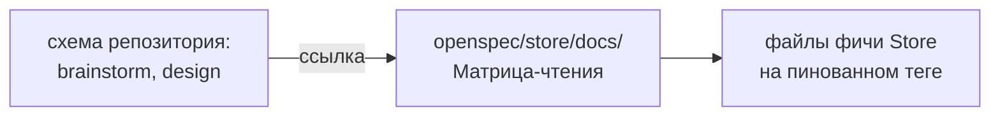

# 06. Работа с Gigacode

Gigacode (форк Qwen Code) используется и аналитиками, и разработчиками. Схемы OpenSpec задают агенту шаги и ограничения, а человек управляет процессом.

## Аналитик: brainstorm в Store

Аналитик работает с агентом в формате **brainstorm**: агент задаёт вопросы по одному, уточняет, предлагает варианты и только потом пишет файлы фичи.

### Откуда агент берёт «текущее состояние» системы

**Только из Store.** Источник текущего состояния frontend, backend и DB — master spec по модулям, архив прошлых фич и БТ. Доступа к коду или к master spec кодовых репозиториев у агента аналитика нет: это нарушило бы принцип чёрного ящика и привело бы в контекст детали реализации.

Если Store и реальное поведение сервиса разошлись, это оформляется как исправление ФТ (см. [[04-Жизненный-цикл-фичи]], случай 2).

### Чего агент аналитика не пишет

В инструкциях схемы Store для каждого артефакта прямо указано, чего писать нельзя:

- названия классов, пакетов, компонентов, хуков;
- выбор СУБД и SQL под конкретную СУБД;
- кэш, очереди, внутренние сервисы;
- вёрстку и устройство компонентов.

### Пример диалога (фрагмент)

> **Агент.** В БТ сказано «быстро находить нужную заявку». Какие критерии отбора нужны пользователю в первую очередь?
> **Аналитик.** Статус, период создания и исполнитель.
> **Агент.** Статус выбирается один или несколько? Это важно для контракта запроса.
> **Аналитик.** Несколько.
> **Агент.** Принято. Что должно происходить, если выбраны фильтры, а заявок нет?

Каждый вопрос уточняет одно решение. Решения затем фиксируются в `FRD.md`, `BFRD.md`, `FFRD.md` и `contracts/`.

## Разработчик: чтение Store

### Матрица чтения по умолчанию

Агент разработчика читает файлы фичи на пинованном теге Store по папке, на которую указывает `store-feature`.

| Файл | Backend | Frontend |
|---|---|---|
| `FRD.md` | да | да |
| `BFRD.md` | да | нет |
| `FFRD.md` | нет | да |
| `contracts/api.yaml` | да | да |
| `contracts/data-model.yml` | да | нет |
| `contracts/integrations.*` | да | нет |
| master spec модулей из таблицы `FRD.md` | да | да |
| БТ (`BRD.md`) | по запросу | по запросу |

Это поведение **по умолчанию**. Разработчик вправе прямым промптом или настройкой агента расширить чтение (например, попросить прочитать БТ). Запретов нет: матрица нужна, чтобы агент по умолчанию не тратил контекст на лишнее.

### Где записана матрица

Матрица и порядок чтения для backend и для frontend описаны в инструкциях Store (`docs/Матрица-чтения-backend.md` и `docs/Матрица-чтения-frontend.md`). Одна копия на все команды, версионируется вместе с Store.

В локальной схеме шаги `brainstorm` и `design` содержат короткое указание: «прочитай инструкцию своей части в `openspec/store/docs/` на пинованном теге и действуй по ней». Так при изменении структуры Store правится одно место, а не каждый репозиторий.

### Работа агента по change

1. Читает `proposal.md` change: находит `store-feature` и `store-version`.
2. Читает файлы Store по матрице своей части.
3. Ведёт brainstorm с разработчиком, формирует `design.md`, `specs/`, `tasks.md`, `plan.md`.
4. Реализует по плану (worktree и субагенты схемы superpowers-bridge, вместе с TDD и код-ревью).
5. Формирует `verify.md`, после проверки архивирует change.

При изменении ФТ в процессе разработки агент сравнивает папку фичи между тегами (см. [[04-Жизненный-цикл-фичи]], случай 1).

Следующий шаг: [[07-Внедрение]].
