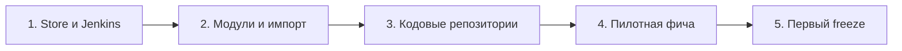

# 07. Внедрение

Как команде завести подход с нуля, если код уже есть, а Store пока пуст.

## Принцип: постепенно

Не нужно сначала описывать всю систему. Начальный master spec содержит только то, что уже существует в виде контрактов, а описание поведения накапливается по мере архивации фич.

## Шаги

| № | Шаг | Результат | Кто |
|---|---|---|---|
| 1 | Завести репозиторий Store в Bitbucket, добавить `docs/`, `business-requirements/`, `changes/`, `specs/` | пустой Store со структурой | аналитик, DevOps |
| 2 | Настроить в Jenkins задачу тегов фич по вебхуку Bitbucket (мерж в `master`) | теги `HRPPRBCI-XXXX/vN` ставятся автоматически | DevOps |
| 3 | Подготовить скрипт `store-archive` и схему OpenSpec для Store | архивация одной командой | аналитик, DevOps |
| 4 | Определить список модулей, создать каркас `specs/<модуль>/` | каркас модулей | аналитик, архитекторы |
| 5 | Импортировать существующие контракты (OpenAPI, логическая модель данных) в `specs/` | начальный master spec | аналитик, разработчики |
| 6 | Импортировать существующие ФТ из Confluence в новый формат (`FRD.md`, `BFRD.md`, `FFRD.md`), где возможно, разделив по частям | ФТ в Store | аналитик |
| 7 | Скопировать БТ в `business-requirements/` | БТ в Store | аналитик |
| 8 | Написать инструкции в `docs/` (принципы, встраивание, матрицы чтения) | инструкции Store | аналитик, разработчики |
| 9 | В каждом кодовом репозитории подключить Store как submodule | `openspec/store/` | разработчик |
| 10 | Скопировать схему superpowers-bridge в `openspec/schemas/`, добавить ссылку на инструкции Store в `brainstorm` и `design` | локальная схема | разработчик |
| 11 | Подключить pre-push хук и шаг codegen в `Jenkinsfile` | проверки работают | разработчик, DevOps |
| 12 | Провести пилотную фичу по всему циклу | отработанный процесс | вся команда |
| 13 | Закрыть первый релиз: `release/x.y.z`, `store-archive`, тег | первый тег релиза Store | аналитик |

## Что нужно от команды

- Jira с идентификаторами вида `HRPPRBCI-XXXX` для историй, исправлений и задач разработки.
- Доступ аналитиков к Gigacode и к Store (PR и тег релиза в интерфейсе Bitbucket).
- Подключённый плагин Superpowers и Gigacode с поддержкой субагентов у разработчиков.
- Договорённость о составе модулей Store.

## Критерий готовности

- Одна фича прошла путь от БТ до тега релиза Store.
- Разработчики пинят Store на тег, а не копируют файлы.
- Сборка проверяет контракт через codegen.
- Команда понимает, где искать ФТ (Store) и где искать реализацию (кодовый репозиторий).

## Что пока не решено

Эти пункты намеренно оставлены на практику внедрения или требуют уточнения при настройке.

| Тема | Состояние |
|---|---|
| Жёсткий шаблон `FRD.md` | отложен: будет сформирован по результатам практики |
| Формат разделов текстовых файлов для `store-archive` (added, modified, removed) | входит в жёсткий шаблон ФТ |
| Размещение корня OpenSpec-проекта в корне репозитория Store (структура `changes/`, `specs/` без вложенной папки `openspec/`) | проверить при настройке `store-archive` |
| Пост-проверка Jenkins при пуше тега релиза (формат `x.y.z`, возрастание версии, соответствие `Impact`) | рекомендуется, не подтверждено |
| Имя ветки `release/x.y.z` для PR релиза | предложено, подтвердить на практике |
| Автоматические уведомления в Jira о новом теге фичи | сейчас вручную |
| Проверки соответствия кода ФТ вне контракта API | не вводятся, зона ответственности разработчиков |
