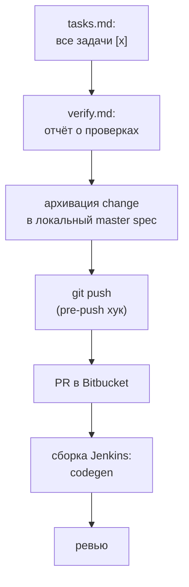
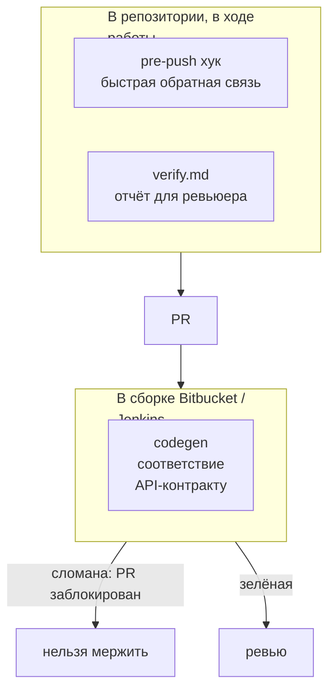
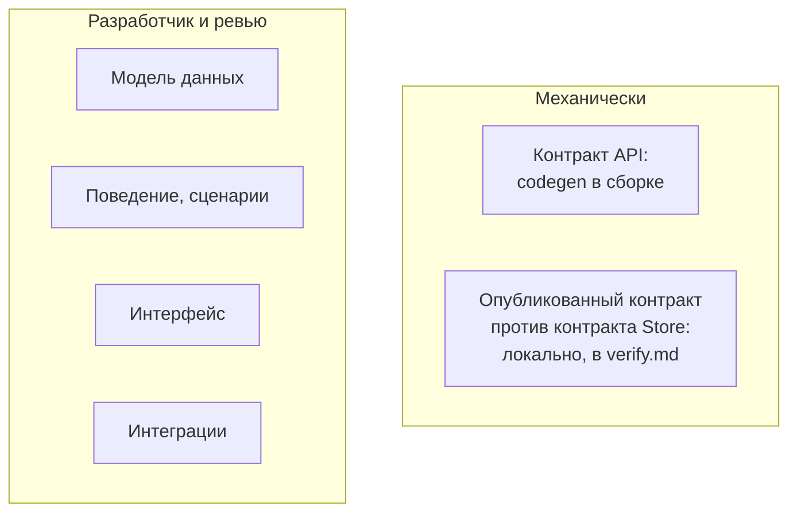
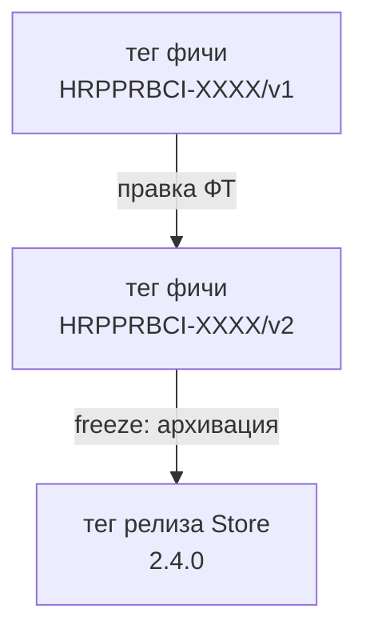
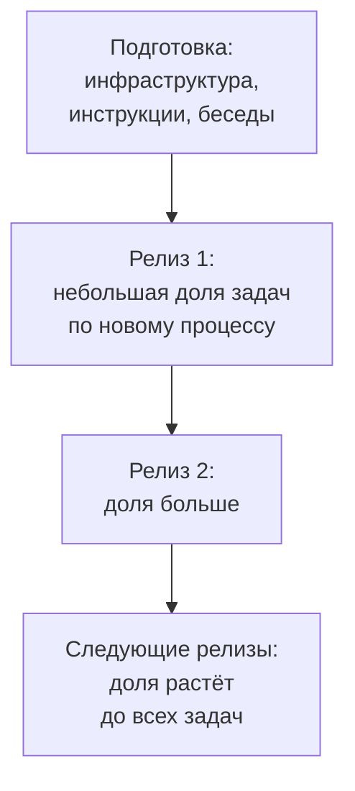
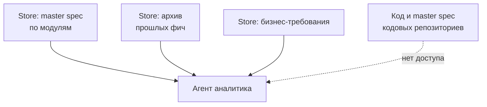

# Как после реализации в кодовом репозитории происходит проверка?
Разработчик доводит change до конца, фиксирует результаты проверок, архивирует change в локальный master spec и открывает PR. Перед пушем срабатывает pre-push хук, после открытия PR сборка Jenkins проверяет соответствие кода API-контракту.

Порядок действий:
1. **Закрытие задач.** Разработчик и агент Gigacode доводят реализацию до конца и отмечают все пункты в локальном файле `tasks.md` как выполненные (`[x]`).
2. **Отчёт о проверках.** В артефакте `verify.md` change фиксируются результаты проверок: формальные признаки change и сравнение опубликованного контракта сервиса с контрактом Store.
3. **Архивация change.** Разработчик архивирует change в локальный master spec сервиса в той же ветке, до мержа PR.
4. **Push.** Разработчик пушит ветку (`feature/HRPPRBCI-XXXX`), при этом срабатывает pre-push хук.
5. **Pull Request.** Разработчик открывает PR в Bitbucket в репозитории своего сервиса и прикладывает `verify.md`.
6. **Сборка.** Открытие или обновление PR запускает сборку в Jenkins, в которой выполняется проверка codegen.
7. **Ревью.** Ревьюер читает отчёт `verify.md` и решает, достаточно ли его.

**Пример.** Backend-разработчик закончил change `request-filters-api` (фильтры в списке заявок). Все задачи в `tasks.md` отмечены, в `verify.md` стоят «да» напротив всех проверок, change перенесён в архив. Разработчик делает `git push`, хук молчит, открывает PR. Jenkins собирает проект: код генерируется из контракта, рукописный код компилируется, сборка зелёная. Ревьюер видит приложенный `verify.md` и одобряет PR.

# Какие проверки есть и где они выполняются?
Проверки делятся по месту и строгости, потому что механически можно проверить только контракт взаимодействия. Остальное остаётся ответственностью разработчиков (принцип чёрного ящика).

- **Pre-push хук** (запускается локально при push). Блокирует push, если имя ветки не соответствует формату `feature/HRPPRBCI-XXXX` или `fix/HRPPRBCI-XXXX`, если в change нет `jira-id`, если у change с фичей Store submodule не пинован на существующий тег или тег не совпадает с `store-version`. Только предупреждает, если у change с закрытыми задачами нет `verify.md` и если завершённый change не архивирован. Хук можно обойти (`--no-verify`): он даёт быструю обратную связь, но не гарантию.
- **Отчёт `verify.md`** (составляется в репозитории в ходе работы). Фиксирует, какие проверки выполнены и с каким результатом, включая сравнение опубликованного контракта сервиса с контрактом Store. Прикладывается к PR, оценивает его ревьюер.
- **Сборка в Jenkins** (запускается на PR в Bitbucket). Выполняет единственную автоматическую проверку соответствия, codegen: полный контракт строится из актуального контракта на пинованном теге Store плюс фрагментов `api.yaml` фич из changes этого PR, из него при каждой сборке генерируются интерфейсы и типы (они не коммитятся в репозиторий), а рукописный код, не соответствующий им, ломает сборку и блокирует PR.

**Пример сообщений хука.**

| Ситуация | Что произойдёт |
|---|---|
| ветка называется `my-filters` | push заблокирован: имя ветки должно быть `feature/HRPPRBCI-XXXX` |
| в `proposal.md` change нет `jira-id` | push заблокирован: укажите `jira-id` |
| submodule Store стоит на ветке, а не на теге | push заблокирован: пин должен быть на теге, равном `store-version` |
| все задачи закрыты, `verify.md` нет | push проходит, хук выводит предупреждение |
| change завершён, но не архивирован | push проходит, хук выводит предупреждение |

# Как проверяется, что реализация соответствует ФТ?
Механически проверяется только контракт взаимодействия, всё остальное проверяют разработчик и ревью.

- **Контракт API (механически).** Интерфейсы и типы генерируются из контракта Store, поэтому код, не реализующий или не использующий их корректно, не пройдёт сборку. Лишний эндпоинт, которого нет в контракте, сборка не заметит: его ловит локальное сравнение опубликованного контракта сервиса с контрактом Store, результат которого записан в `verify.md`.
- **Границы изменения.** Фича в Store описывает именно изменение (фрагмент контракта, дельту модели данных), а локальные specs change используют дельта-формат OpenSpec: разделы `## ADDED Requirements`, `## MODIFIED Requirements`, `## REMOVED Requirements`.
- **Объём работы.** Разработчик декомпозирует работу в `tasks.md`. Если все задачи закрыты, а `verify.md` нет или change не архивирован, pre-push хук выдаёт предупреждение.
- **Остальное.** Модель данных, поведение, интерфейс и интеграции формально не проверяются: это чёрный ящик, за соответствие отвечает разработчик, а проверяет ревьюер.

**Примеры.**

| Что сделал разработчик | Кто это поймает |
|---|---|
| в запросе списка заявок назвал параметр `statusFilter`, а в контракте `status` | сборка: сгенерированный интерфейс требует `status`, код не компилируется |
| не добавил обработку ошибки `INVALID_PERIOD`, хотя контракт описывает ответ `400` | сборка не заметит (код компилируется), поймают тесты и ревьюер |
| добавил в backend лишний эндпоинт `GET /requests/export`, которого нет в контракте | локальное сравнение контрактов покажет расхождение в `verify.md`, сборка пройдёт |
| забыл создать индекс по `status` и дате создания | никто автоматически: проверяет разработчик и ревьюер по описанию модели данных в Store |

# Как репозиторий Store подключается к кодовым репозиториям?
Store подключается как git submodule внутрь кодового репозитория сервиса (путь `openspec/store`), поэтому физически лежит в проекте, а не на машине разработчика. Submodule всегда пинится на тег: на тег фичи `HRPPRBCI-XXXX/vN` во время работы и на тег релиза Store `x.y.z` после архивации фичи. Пинить на коммит или на плавающую ветку `master` нельзя: сборки станут нестабильными, а агент будет читать меняющуюся документацию.

| Когда | На какой тег пинить |
|---|---|
| фича согласована и в разработке | на тег фичи, например `HRPPRBCI-XXXX/v1` |
| ФТ фичи изменилось | на новый тег фичи `HRPPRBCI-XXXX/v2`, когда разработчику удобно перейти |
| фича архивирована на freeze | на тег релиза Store, например `2.4.0` |
| никогда | на `master` Store или на отдельный коммит |

Порядок подключения:
1. Добавить submodule: `git submodule add <адрес Store в Bitbucket> openspec/store`.
2. Закрепить на теге: `git -C openspec/store checkout HRPPRBCI-XXXX/v1`, затем закоммитить изменение submodule.
3. При необходимости зарегистрировать Store в CLI OpenSpec: `openspec store register ./openspec/store --id <id>`.
4. При клонировании сервиса подтягивать submodule: `git submodule update --init`.

**Пример.** Разработчик frontend начинает фичу с фильтрами. Аналитик уже смержил ФТ, и Jenkins поставил тег `HRPPRBCI-XXXX/v1`. Разработчик выполняет шаги 1–2, коммитит пин, и теперь в `openspec/store/` лежит ровно то ФТ, с которым он будет работать, пока сам не перейдёт на другой тег. Через неделю аналитик уточняет ФТ, появляется тег `v2`, но у разработчика ничего не меняется, пока он сам не перепинит submodule.

# Как будет происходить переходный период?
Я буду выстраивать инфраструктуру в кодовых репозиториях и для OpenSpec store. Будут написаны инструкции по работе и проведены разъяснительные беседы. Также я буду выступать в качестве специалиста поддержки этого процесса, коллеги всегда могут обратиться ко мне с вопросами. Для плавности перехода в рамках релиза будут выбираться задачи для пилота, процент таких задач будет прогрессирующим от релиза к релизу.

# Сверяется ли агент аналитика с кодом, несмотря на наличие master spec?
Нет. Агент аналитика берёт текущее состояние системы только из Store: из master spec по модулям, архива прошлых фич и бизнес-требований. Доступа к коду и к master spec кодовых репозиториев у него нет, потому что тогда в контекст попали бы детали реализации, а это нарушает принцип чёрного ящика.

- **Что даёт опору агенту.** При внедрении в Store импортируются существующие контракты (Swagger/OpenAPI), логическая модель данных и существующие ФТ из Confluence. С этого момента они служат основой для агента.
- **Если Store и реальное поведение разошлись.** Аналитик и разработчик вместе решают в комментариях Jira-бага, где ошибка. Если в ФТ, исправление оформляется как фича типа `fix` (ветка `fix/HRPPRBCI-XXXX`, `Impact: patch`) и идёт тем же процессом с ревью. Если в коде, исправляется только код, а Store не меняется.
- **Агент разработчика.** По умолчанию читает только файлы своей части по матрице чтения, но разработчик вправе прямым промптом расширить чтение, например на бизнес-требования. Запретов нет.

**Пример.** Аналитик просит агента добавить в список заявок фильтр по исполнителю. Агент смотрит в Store, что список заявок уже умеет отдавать постранично (описано в master spec модуля), и задаёт уточняющие вопросы, не заглядывая в код. Разработчик позже замечает, что в Store указано «размер страницы до 100», а сервис реально ограничивает 50. В Jira-баге они вместе решают, что ошибка в коде, и исправляют только код, а Store остаётся прежним.
