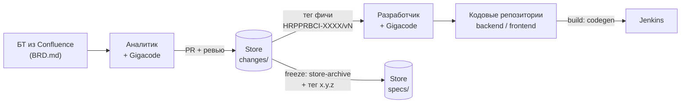

# Кейс Sber: SDD на OpenSpec, Gigacode, Jenkins и Bitbucket

> Условный кейс реализации. Описывает целиком, как команда выстраивает разработку по спецификациям: аналитики описывают функциональные требования (ФТ) в общем репозитории **Store**, разработчики реализуют их в своих репозиториях. Документ можно отправить команде как инструкцию по внедрению.

## Контекст кейса

| Параметр | Значение |
|---|---|
| Роли | системные аналитики, разработчики (backend, frontend) |
| Backend | Java, Spring |
| Frontend | React, Webpack |
| AI-агент | Gigacode (форк Qwen Code) |
| CI/CD | Jenkins |
| Git | Bitbucket |
| Трекер и база знаний | Jira, Confluence |
| Инструмент SDD | OpenSpec (схемы Store и superpowers-bridge) |

Технологии нужны только как контекст. Кейс описывает **механизм и архитектуру**, а не детали стека.

## Механизм на одной схеме

Читать слева направо:

1. Аналитик на основе бизнес-требований описывает фичу в Store (в диалоге с Gigacode).
2. После ревью и мержа Jenkins ставит тег фичи.
3. Разработчик подключает Store как git submodule на этот тег и реализует свою часть.
4. Сборка проверяет, что код соответствует контракту взаимодействия.
5. На feature freeze релиза фичи архивируются в актуальное описание системы и получают тег релиза Store.

## Главные решения за минуту

- **Чёрный ящик.** Аналитик описывает, что отдают и принимают frontend, backend, DB и внешние системы. Как это устроено внутри, он не знает и не пишет.
- **Две спецификации.** Store хранит подробное описание взаимодействия и поведения. Кодовые репозитории хранят свой master spec: реализацию и поведение своей части.
- **Файлы по областям.** `FRD.md`, `BFRD.md`, `FFRD.md` и папка `contracts/`. Агент разработчика по умолчанию читает только файлы своей области.
- **Store физически лежит в репозитории** как git submodule и всегда пинится на тег.
- **Два вида тегов.** Тег фичи `HRPPRBCI-XXXX/vN` (автоматически) и тег релиза Store `x.y.z` (вручную, SemVer).
- **Версии независимы.** Версия Store и версии приложений не связаны.
- **Проверки.** Основные идут в репозитории в ходе работы, в сборке Bitbucket остаётся только codegen по API.
- **Jira обязательна.** Любой локальный change привязан к Jira, даже если фичи в Store нет.

## Как читать кейс

| Если вы | Начните с | Затем |
|---|---|---|
| Руководитель, архитектор | этот файл, [[01-Принципы-и-роли]] | [[04-Жизненный-цикл-фичи]] |
| Системный аналитик | [[01-Принципы-и-роли]], [[02-Store]] | [[06-Работа-с-Gigacode]], [[04-Жизненный-цикл-фичи]] |
| Разработчик | [[01-Принципы-и-роли]], [[03-Кодовые-репозитории]] | [[05-Проверки-и-сборка]], [[06-Работа-с-Gigacode]] |
| Внедряете подход в команду | [[07-Внедрение]] | все остальные |
| Хотите увидеть на примере | [пример](example/README.md) | |

## Содержание

| Файл | О чём |
|---|---|
| [[01-Принципы-и-роли]] | чёрный ящик, роли, границы ответственности |
| [[02-Store]] | структура Store, схема артефактов, master spec, теги и версии |
| [[03-Кодовые-репозитории]] | submodule, локальная схема, changes, Jira, ветки |
| [[04-Жизненный-цикл-фичи]] | путь фичи от БТ до архивации и граничные случаи |
| [[05-Проверки-и-сборка]] | проверки в репозитории, pre-push хук, codegen в Jenkins |
| [[06-Работа-с-Gigacode]] | brainstorm аналитика, чтение Store агентом разработчика |
| [[07-Внедрение]] | как завести подход с нуля, что пока не решено |
| [example](example/README.md) | сквозной пример: фича «фильтры в списке заявок» |

## Обозначения

- `HRPPRBCI-XXXX` — пример идентификатора Jira-задачи (истории в Store).
- `x.y.z` — версия релиза Store по SemVer.
- Store, кодовый репозиторий, change, master spec, freeze — основные термины, они разобраны в соответствующих файлах.
