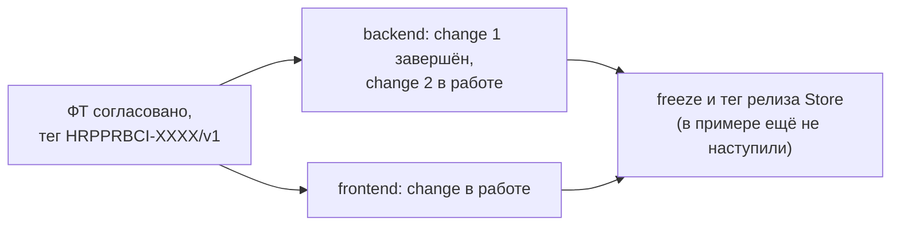

# Пример: фильтры в списке заявок

Сквозной пример к кейсу: на одной небольшой фиче показано, как выглядят **Store**, **кодовый репозиторий backend** и **кодовый репозиторий frontend**, и как они связаны. Основное описание механизма: [README кейса](../README.md).

## Что это

Условная фича «фильтры в списке заявок»: оператор сужает список по статусу, периоду создания и исполнителю. Она затрагивает и backend (новые параметры запроса, индексы), и frontend (панель фильтров). Внешних интеграций нет, поэтому файла `integrations.*` нет: это иллюстрация правила «нет области, нет файла».

Пример верхнеуровневый: показаны формат и связи между файлами, а не реальный код.

## Моментальный снимок

Пример показывает систему в конкретный момент, **до feature freeze**:



| Где | Состояние |
|---|---|
| Store | фича лежит в `changes/` на теге `HRPPRBCI-XXXX/v1`; в `specs/` показано состояние модуля «до фичи» |
| backend | `request-filters-api` завершён и проверен, ждёт архивации; `request-filters-indexes` в работе; `fix-pagination-offset`: пример change без фичи в Store |
| frontend | `request-filters-ui` в работе |

## Как это устроено в реальности и в примере

| В реальности | В примере |
|---|---|
| три отдельных репозитория: Store, backend, frontend | три папки: `store/`, `backend/`, `frontend/` |
| Store подключён в сервисы как git submodule `openspec/store/` | в папках сервисов лежат файлы `SUBMODULE.md`, объясняющие, где был бы submodule |

## Карта файлов

```
example/
├── README.md                                   этот файл
├── store/
│   ├── docs/                                   инструкции внутри Store
│   │   ├── Принципы-работы.md
│   │   ├── Встраивание-в-кодовый-репозиторий.md
│   │   ├── Матрица-чтения-backend.md
│   │   └── Матрица-чтения-frontend.md
│   ├── business-requirements/
│   │   └── BRD-request-filters.md              БТ (копия из Confluence)
│   ├── changes/
│   │   └── HRPPRBCI-XXXX-request-filters/      фича в работе
│   │       ├── FRD.md
│   │       ├── BFRD.md
│   │       ├── FFRD.md
│   │       └── contracts/
│   │           ├── api.yaml
│   │           └── data-model.yml
│   └── specs/requests/                         актуальное описание модуля «до фичи»
├── backend/openspec/
│   ├── store/SUBMODULE.md
│   ├── specs/requests/spec.md                  локальный master spec
│   └── changes/
│       ├── request-filters-api/                change 1 (завершён, не архивирован)
│       ├── request-filters-indexes/            change 2 (в работе)
│       └── fix-pagination-offset/              change без фичи в Store
└── frontend/openspec/
    ├── store/SUBMODULE.md
    ├── specs/requests/spec.md
    └── changes/request-filters-ui/             change (в работе)
```

## Как читать пример

Рекомендуемый порядок:

1. [БТ](store/business-requirements/BRD-request-filters.md): откуда берётся фича.
2. [FRD.md](store/changes/HRPPRBCI-XXXX-request-filters/FRD.md): таблица, идея и ссылки на остальные файлы.
3. [BFRD.md](store/changes/HRPPRBCI-XXXX-request-filters/BFRD.md) и [FFRD.md](store/changes/HRPPRBCI-XXXX-request-filters/FFRD.md): требования по частям.
4. Контракты: [api.yaml](store/changes/HRPPRBCI-XXXX-request-filters/contracts/api.yaml) (фрагмент), [data-model.yml](store/changes/HRPPRBCI-XXXX-request-filters/contracts/data-model.yml) (дельта).
5. Сравните с модулем «до фичи»: [specs/requests](store/specs/requests/FRD.md).
6. Перейдите в кодовый репозиторий: [backend proposal](backend/openspec/changes/request-filters-api/proposal.md), [frontend proposal](frontend/openspec/changes/request-filters-ui/proposal.md).

## Где посмотреть каждое правило

| Правило | Где в примере |
|---|---|
| файлы по областям, нет области — нет файла | `store/changes/…`: есть `BFRD.md` и `FFRD.md`, нет `integrations.*` |
| таблица в начале FRD вместо отдельного паспорта | [FRD.md](store/changes/HRPPRBCI-XXXX-request-filters/FRD.md) |
| ссылка на БТ | таблица в `FRD.md` и [БТ](store/business-requirements/BRD-request-filters.md) |
| фрагмент OpenAPI вместо полного контракта | [contracts/api.yaml](store/changes/HRPPRBCI-XXXX-request-filters/contracts/api.yaml) и полный контракт в [specs](store/specs/requests/contracts/api.yaml) |
| дельта модели данных без привязки к СУБД | [contracts/data-model.yml](store/changes/HRPPRBCI-XXXX-request-filters/contracts/data-model.yml) |
| матрица чтения лежит в Store | [backend](store/docs/Матрица-чтения-backend.md), [frontend](store/docs/Матрица-чтения-frontend.md) |
| метаданные change: `jira-id`, `store-feature`, `store-version` | начало любого `proposal.md` в `backend/` и `frontend/` |
| декомпозиция одной фичи на несколько changes в одной ветке | два changes backend с одинаковым `jira-id` |
| декомпозиция на уровне Jira: другой `jira-id` | frontend `request-filters-ui` (`HRPPRBCI-YYYY`) |
| change без фичи в Store (баг реализации) | [fix-pagination-offset](backend/openspec/changes/fix-pagination-offset/proposal.md) |
| отчёт о проверках | [verify.md](backend/openspec/changes/request-filters-api/verify.md) |
| локальный master spec | `specs/requests/spec.md` в backend и frontend |
| дельта локального master spec | [specs в change](backend/openspec/changes/request-filters-api/specs/requests/spec.md) |

## Чтение в Obsidian

Все файлы примера видимы (скрытых папок и файлов нет). Файлы `.yaml` и `.yml` Obsidian по умолчанию не показывает: чтобы они появились в списке файлов, включите в настройках **Files and links → Detect all file extensions**. Без этой настройки формат контрактов можно посмотреть в выдержках в [02-Store](../02-Store.md), а смысл параметров и правил описан в `BFRD.md` и `FFRD.md` фичи.

## Упрощения примера

- Кода нет: показаны только артефакты спецификаций.
- Артефакты локальной схемы показаны выборочно (`proposal`, `design`, `tasks`, `verify`, `specs`): остальные (`brainstorm`, `plan`, `retrospective`) устроены так же.
- Содержание условное, Jira ID заменены на `HRPPRBCI-XXXX`, `HRPPRBCI-YYYY`, `HRPPRBCI-ZZZZ`.
