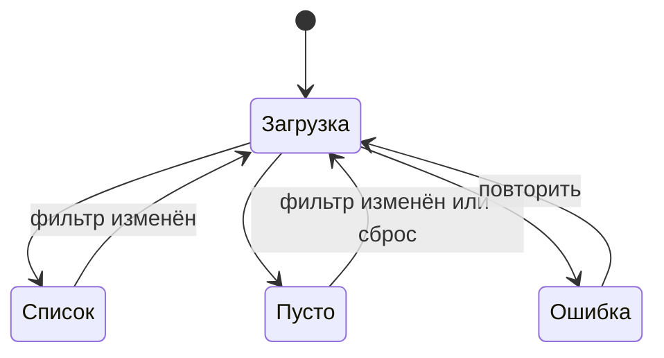

# FFRD: фильтры в списке заявок (frontend)

Единое описание фичи: [FRD.md](FRD.md).

## Что меняется на экране «Список заявок»

Над таблицей появляется панель фильтров.

```
┌─────────────────────────────────────────────────────────────┐
│ Статус [▾ выбрано: 2]  Создана с [дата]  по [дата]          │
│ Исполнитель [▾ любой]                       [Сбросить]      │
├─────────────────────────────────────────────────────────────┤
│ № │ Название │ Статус │ Исполнитель │ Создана               │
│ ...                                                         │
└─────────────────────────────────────────────────────────────┘
```

Макет: ссылка на Figma (в примере не приводится).

## Элементы

| Элемент | Поведение |
|---|---|
| Статус | выпадающий список с множественным выбором; показывает число выбранных значений |
| Создана с, по | два поля даты; если начало позже конца, поле конца подсвечивается, запрос не отправляется, под полем подсказка |
| Исполнитель | выпадающий список; значение по умолчанию «любой» |
| Сбросить | очищает все фильтры; доступна, только если выбран хотя бы один фильтр |

## Поведение

1. Применение фильтров происходит сразу при изменении значения, без отдельной кнопки.
2. При изменении любого фильтра пагинация возвращается на первую страницу.
3. Выбранные фильтры отражаются в адресной строке и восстанавливаются при загрузке страницы.
4. Пока идёт запрос, таблица показывает состояние загрузки.
5. Если по фильтрам нет заявок, показывается «По выбранным фильтрам заявок нет» и кнопка «Сбросить».
6. Если сервер вернул ошибку, показывается сообщение с кнопкой «Повторить», выбранные фильтры не теряются.

## Состояния экрана



## Контракты

Запрос и ответ описаны в [contracts/api.yaml](contracts/api.yaml).
