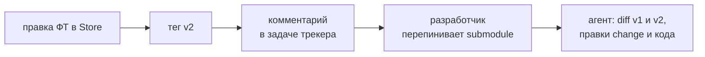

# Изменение ФТ в ходе разработки

**Ситуация.** Фича согласована и имеет тег `PROJ-1234/v1`. Разработка уже идёт, и аналитик вносит правку в ФТ.

## Порядок действий

1. Аналитик вносит правку через PR (ветка `feature/PROJ-1234` или `fix/PROJ-1234`), проходит ревью. После мержа CI ставит следующий тег фичи `PROJ-1234/v2`.
2. Аналитик пишет комментарий в задаче трекера фичи: новый тег и краткое описание изменений. Уведомление ручное, автоматического нет.
3. Разработчик сам решает, когда перейти: пинит submodule на `PROJ-1234/v2` и обновляет `store-version` в затронутых changes.
4. Агент сравнивает папку фичи между тегами `v1` и `v2` (`git diff` между тегами) и вносит правки в артефакты change (`design`, `specs`, `tasks`) и в код.
5. Если часть реализации уже смержена, правки оформляются **новым change** под тем же `store-feature`.

## Почему так

- Разработчик не обязан немедленно переходить на новую версию: он завершает текущий этап и сам выбирает момент.
- Разница между версиями вычисляется механически (diff между тегами), агенту не нужно «угадывать», что изменилось.
- Тег указывает на согласованное состояние, поэтому разработчик не получает неутверждённых черновиков.
