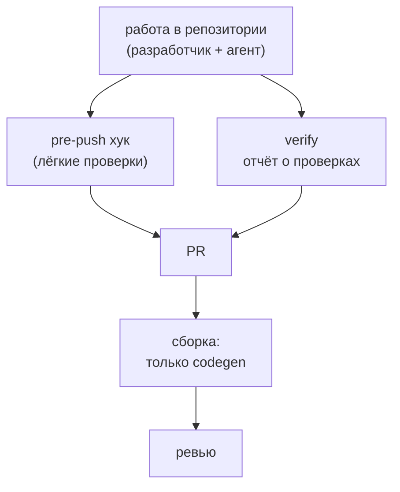

# Контроль соответствия

Принцип: **жёстко проверяем только то, что можно проверить механически**: контракт взаимодействия. Всё остальное это ответственность разработчиков и их реализации (концепция чёрного ящика).

## Где что проверяется

| Что | Где | Строгость |
|---|---|---|
| Соответствие кода API-контракту Store | сборка кодового репозитория, шаг codegen | блокирует PR |
| Формальные признаки change | pre-push хук | блокирует при ошибках формата |
| Неоформленные шаги change | pre-push хук | предупреждает |
| Сравнение опубликованного контракта сервиса с контрактом Store | в репозитории, в ходе работы | фиксируется в `verify` |
| Модель данных, поведение, интерфейс, интеграции | разработчик и ревью | формальных проверок нет |

## Проверки в репозитории

Скрипты проверок лежат в кодовом репозитории и версионируются вместе с кодом. Разработчик и агент запускают их локально до PR. Результаты записываются в отчёт `verify`, который прикладывается к PR. В чек-лист PR входит пункт «отчёт `verify` приложен», ревьюер решает, достаточно ли его.

## Pre-push хук

Лёгкие версии основных проверок для быстрой обратной связи.

| Проверка | Реакция |
|---|---|
| имя ветки соответствует формату (`feature/PROJ-1234`, `fix/PROJ-1234`) | блокирует |
| в каждом локальном change есть `jira-id` | блокирует |
| при наличии `store-feature` submodule пинован на существующий тег, `store-version` совпадает | блокирует |
| для change с закрытыми задачами в `tasks.md` есть `verify` | предупреждает |
| завершённый change не архивирован | предупреждает |

Пуш незавершённой работы должен проходить, поэтому два последних пункта только предупреждают. Хук можно обойти (`--no-verify`): он даёт обратную связь, а не гарантию. Фактом проверки служит отчёт `verify` и ревью. Скрипты хуков хранятся в репозитории и подключаются автоматически при первой сборке, вручную ничего ставить не нужно.

## Сборка: только codegen

Единственная проверка соответствия в сборке: код соответствует контракту взаимодействия из Store.

1. Сборка получает **полный контракт**: актуальный контракт из `specs/` на пинованном теге плюс фрагменты `api.yaml` фич, на которые ссылаются changes этого PR (`store-feature`). Чужие фичи в работе в контракт не попадают.
2. Из полного контракта **при каждой сборке** генерируется код (интерфейсы и DTO для backend, типы и клиент для frontend). Сгенерированный код **не коммитится**.
3. Рукописный код реализует сгенерированные интерфейсы и использует сгенерированные типы. Расхождение с контрактом даёт ошибку сборки.

Ограничение: сборка ловит только то, что отражено в сгенерированном коде. Лишний эндпоинт, которого нет в контракте, ловит локальная проверка сравнения опубликованного контракта с Store.

## Что намеренно не проверяется

| Область | Почему |
|---|---|
| модель данных | логическая модель не привязана к СУБД, соответствие оценивает разработчик |
| поведение, сценарии | интерпретация, а не механическая сверка |
| интерфейс | то же |
| внутренняя реализация | чёрный ящик для аналитика и Store |
