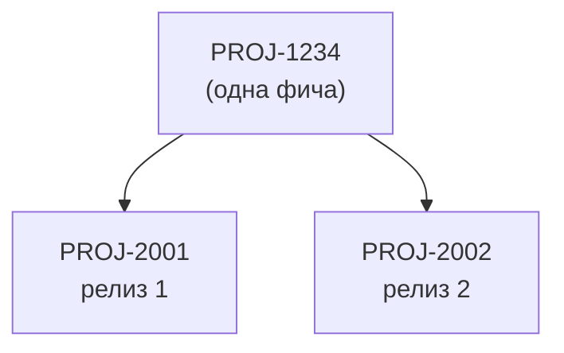

# Разделение фичи на релизы

**Ситуация.** Фича уже лежит в `changes/` Store (смержена в основную ветку), и принято решение выпускать её частями в разные релизы, как отдельные задачи в трекере.

## Почему нельзя оставить фичу целой

Критерий архивации требует, чтобы все задачи фичи были закрыты в релизе. Если оставить фичу одной, её первая часть уйдёт в эксплуатацию, а master spec не будет её описывать до последнего релиза. Это нарушает принцип «master spec описывает реализованное».

## Порядок действий

1. Аналитик создаёт для каждой части новую фичу в Store со своим ID задачи (`PROJ-2001`, `PROJ-2002`). Каждая часть самостоятельна: свои `FRD.md`, `BFRD.md`/`FFRD.md` и `contracts/`.
2. В таблице `FRD.md` каждой новой фичи указано поле «Выделена из: PROJ-1234».
3. Исходная папка удаляется из `changes/` (история остаётся в git и тегах).
4. Каждая новая фича идёт по общему процессу: свои PR, ревью, теги, критерий архивации.
5. Аналитик сообщает разработчикам комментарием в трекере. Разработчики пинят submodule на теги новых фич и меняют `store-feature` в затронутых changes.

## Требование к разделению

Контрактные фрагменты частей должны быть независимы, то есть не пересекаться по одним и тем же операциям или сущностям. Если части зависят друг от друга, это оговаривается в `FRD.md`: порядок реализации и архивации важен.
