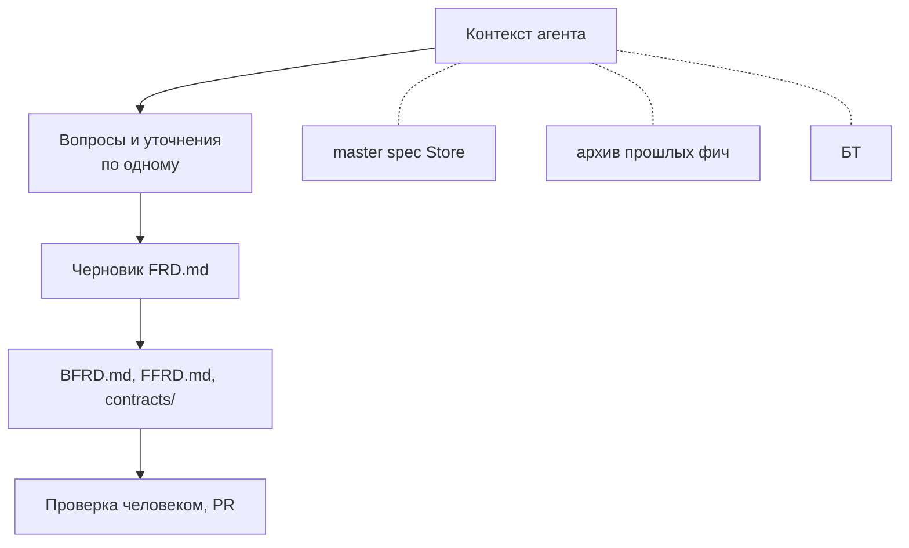

# Работа аналитика со Store

Системный аналитик ведёт функциональные требования в Store. Он описывает **что и как взаимодействует**, но не **как устроено внутри** (принцип чёрного ящика, см. [[OpenSpec/store/Принципы Store и чёрный ящик]]).

## Что делает аналитик

1. Копирует бизнес-требования (БТ) в `business-requirements/` Store, если их там ещё нет.
2. Описывает фичу в Store: `FRD.md`, `BFRD.md`, `FFRD.md`, `contracts/` (структура: [[OpenSpec/store/Структура Store и артефакты фичи]]).
3. Проводит PR через ревью: коллега-аналитик и по одному представителю каждой затронутой части.
4. Сообщает разработчикам об изменениях ФТ комментарием в задаче трекера.
5. На feature freeze архивирует фичи релиза и вручную ставит тег релиза Store `x.y.z` ([[OpenSpec/store/Архивация и релиз Store]]).

## Работа через агента в формате brainstorm

Вся работа аналитика идёт через AI-агента в формате **brainstorm**: агент задаёт вопросы и уточняет решения по одному, и только затем формирует файлы фичи.

**Источник контекста.** Текущее состояние frontend, backend и DB агент берёт **только из Store**: master spec по модулям, архив прошлых фич и БТ. Доступа к коду и к master spec кодовых репозиториев у агента аналитика нет: это нарушило бы принцип чёрного ящика и привело бы в контекст детали реализации. Если Store и реальность разошлись, это оформляется как исправление ФТ ([[OpenSpec/gates/Исправление ошибки в ФТ]]).

**Чего агент не пишет.** В инструкциях схемы Store для каждого артефакта прямо указано: никаких классов, пакетов, компонентов, хуков, выбора СУБД и SQL под конкретную СУБД, кэша, очередей, внутренних сервисов, вёрстки.

**Шаблон.** Структура ФТ задаётся схемой OpenSpec для Store. Жёсткий шаблон `FRD.md` формируется по результатам практики для единообразия.

## Что аналитик указывает в таблице `FRD.md`

ID задачи трекера, название, тип (feature или fix), ссылку на БТ, затронутые модули, части (backend, frontend) и `Impact` (major, minor, patch). `Impact` определяет повышение версии релиза Store.

## Что аналитик не делает

- Не пишет реализацию и не выбирает технологии.
- Не работает с git submodule (это зона разработчиков).
- Не ставит теги фич: их ставит CI при мерже.

## Граничные случаи

| Случай | Документ |
|---|---|
| ФТ изменилось, когда разработка идёт | [[OpenSpec/gates/Изменение ФТ в ходе разработки]] |
| Ошибка в ФТ | [[OpenSpec/gates/Исправление ошибки в ФТ]] |
| Фичу выпускают частями | [[OpenSpec/gates/Разделение фичи на релизы]] |
