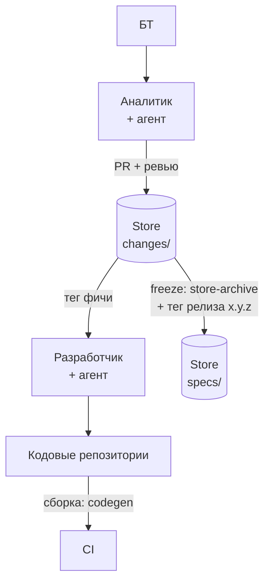

# Store: общие механизмы

Раздел описывает общие (не привязанные к команде) принципы и механизмы работы со **Store** — общим репозиторием функциональных требований. Конкретная реализация показана в [[OpenSpec/cases/КП/README|кейсе Sber]], она же служит эталоном: при расхождении правильным считается кейс.

## Документы

| Документ | О чём |
|---|---|
| [[Принципы Store и чёрный ящик]] | чёрный ящик, две спецификации, сквозные принципы |
| [[Структура Store и артефакты фичи]] | папки Store, файлы фичи, форматы контрактов, master spec по модулям |
| [[Версионирование и теги Store]] | тег фичи и тег релиза, SemVer, независимость версий |
| [[Подключение Store к кодовым репозиториям]] | submodule, пин на тег, локальная схема, метаданные change |
| [[Архивация и релиз Store]] | feature freeze, `store-archive`, ветки и ревью |
| [[Сквозной жизненный цикл фичи]] | четыре этапа от идеи до архивации |
| [[FAQ\|FAQ кейса Sber]] | ответы на частые вопросы по проверкам, подключению и работе агентов |

## Смежные разделы

- Роли: [[OpenSpec/roles/Общие положения]]
- Граничные случаи и проверки: [[OpenSpec/gates/Общие положения]]
- Кейс реализации: [[OpenSpec/cases/КП/README|Sber]]
