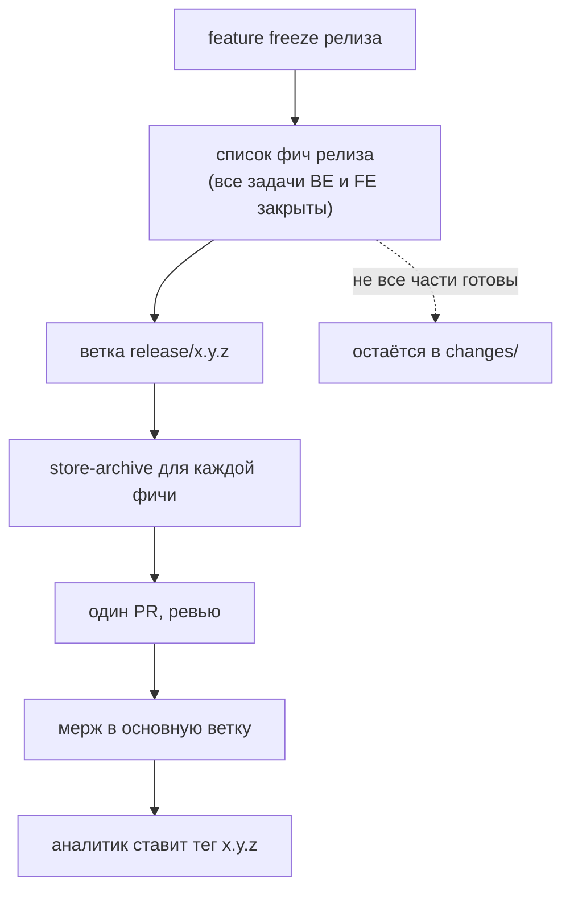

# Архивация и релиз Store

Фича попадает из `changes/` в `specs/` через архивацию, которая происходит на **feature freeze** релиза, а не при мерже кода.

## Почему на feature freeze

Фича может декомпозироваться на несколько changes в нескольких репозиториях, поэтому момент «реализовано» неочевиден. Решение принимает человек, который отвечает за ФТ, а проверки делает автоматика. Так master spec описывает только реализованное.

## Процедура

1. Аналитик определяет фичи, вошедшие в релиз.
2. Создаёт ветку `release/x.y.z`.
3. Для каждой фичи запускает скрипт `store-archive`.
4. Открывает один PR на все фичи релиза, проходит ревью.
5. После мержа вручную ставит тег релиза `x.y.z` на коммит основной ветки.
6. Разработчики перепинивают submodule на тег релиза при ближайшей работе.

## Критерий попадания фичи в архивацию

Фича архивируется, когда **все связанные задачи разработки (backend и frontend) закрыты в этом релизе**. Если реализована только одна часть, фича остаётся в `changes/` целиком и ждёт следующего релиза. Master spec не описывает то, что реализовано наполовину.

Если фичу решили выпускать частями в разные релизы, её сначала делят в Store на независимые фичи: [[OpenSpec/gates/Разделение фичи на релизы]].

## Скрипт `store-archive`

Штатная команда `openspec archive` вливает в master spec только текстовые дельты из `specs/<модуль>/spec.md`. Остальные файлы изменения она просто переносит в архив. Для схемы с областями и контрактами нужна обёртка `store-archive`, которая:

1. вызывает `openspec archive --skip-specs` (папка фичи уходит в `changes/archive/`);
2. вливает файлы фичи в `specs/<модуль>/` по детерминированным правилам.

| Файл | Правило вливания |
|---|---|
| `contracts/api.yaml` | по ключу «путь + метод» и имени схемы: новое добавляется, изменённое заменяется целиком, перечисленное в `x-removed` удаляется |
| `contracts/data-model.yml` | по имени сущности и поля или индекса: `added`, `modified`, `removed` |
| `contracts/integrations.*` | так же, как `api.yaml` |
| `FRD.md`, `BFRD.md`, `FFRD.md` | по разделам, помеченным как добавленные, изменённые или удалённые |

Точный формат разделов текстовых файлов входит в жёсткий шаблон ФТ и уточняется по практике.

## Ветки и ревью в Store

| Ветка | Назначение |
|---|---|
| `master` | согласованное состояние Store |
| `feature/PROJ-1234` | новая фича |
| `fix/PROJ-5678` | исправление ошибки в ФТ |
| `release/x.y.z` | архивация фич релиза |

Ветки короткоживущие: из `master`, через PR обратно в `master`. На ревью PR с ФТ обязательны коллега-аналитик и по одному представителю каждой затронутой части (backend и/или frontend, по таблице `FRD.md`): разработчики видят контракты до начала работы и находят нереализуемое.

Теги: [[Версионирование и теги Store]].
