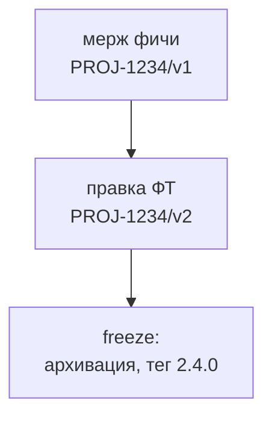

# Версионирование и теги Store

В Store два вида тегов с разным смыслом.

| | Тег фичи | Тег релиза Store |
|---|---|---|
| Формат | `PROJ-1234/vN` | `x.y.z` (SemVer) |
| Когда | при каждом мерже PR, затрагивающего фичу | при архивации на feature freeze |
| Кто ставит | CI автоматически | аналитик вручную |
| Что фиксирует | согласованное состояние фичи | состояние Store с реализованными фичами релиза |
| Для чего | разработчик пинит submodule во время работы | разработчик пинит submodule после архивации |

## Почему два вида тегов

Разработка идёт, пока фича ещё лежит в `changes/` и не архивирована, а тег релиза ставится только при архивации. Пинить submodule на коммит неудобно и непонятно аналитикам, поэтому каждое согласованное состояние фичи получает свой тег. Номер документации при этом растёт только по мере поставки фич, а не при каждом мерже.

Параллельная работа двух аналитиков не создаёт неоднозначности: у каждой фичи свои теги `PROJ-XXXX/vN`. Тег фичи указывает на коммит основной ветки, где лежат и чужие `changes/`, но агент читает только папку своей фичи по ссылке из локального change.

## Тег фичи: автоматически

CI по вебхуку системы хранения кода при мерже в основную ветку:

1. берёт ID задачи из имени ветки (`feature/PROJ-1234` или `fix/PROJ-1234`);
2. находит существующие теги этой фичи и вычисляет следующий номер;
3. ставит тег на коммит мержа в основной ветке.

Первый мерж даёт `v1`, правки после согласования дают `v2`, `v3` и так далее.

Серверный вариант выбран вместо pre-push хука, потому что хук срабатывает до ревью (тег указывал бы на неутверждённое ФТ), создавал бы тег на каждый пуш, указывал бы на коммит ветки, а не на коммит мержа, и ставится локально (его можно обойти).

## Тег релиза Store: вручную

Аналитик ставит тег после мержа PR из ветки `release/x.y.z`, в интерфейсе системы хранения кода. Тег ставится на коммит основной ветки, а не на коммит ветки PR (при squash-мерже это разные коммиты).

### Смысл частей SemVer для Store

| Часть | Когда повышается |
|---|---|
| MAJOR | несовместимое изменение контракта: удалён или изменён эндпоинт или поле так, что старый клиент ломается |
| MINOR | новая фича: добавления, совместимые с прежним |
| PATCH | уточнение или исправление уже архивированной спецификации без новой функциональности |

Версия релиза определяется по **максимальному** `Impact` среди включённых в него фич: хотя бы одна major даёт major, иначе хотя бы одна minor даёт minor, иначе patch. `Impact` аналитик указывает в таблице `FRD.md`.

## Версии Store и приложений независимы

Версия Store не соотносится с версиями backend и frontend:

- один релиз Store касается нескольких сервисов, а у сервисов свои релизные циклы;
- версия сервиса меняется и без изменений в Store (рефакторинг, исправление реализации, зависимости);
- одну версию Store могут реализовывать несколько релизов сервиса.

Вместо совпадения номеров нужна прослеживаемость в одну сторону: сборка сервиса фиксирует, на какую версию Store она опирается. Эту информацию хранит пин submodule, и её стоит записывать в метаданные сборки и релизные заметки сервиса («реализует Store 2.4.0»).

См. также [[Подключение Store к кодовым репозиториям]].
