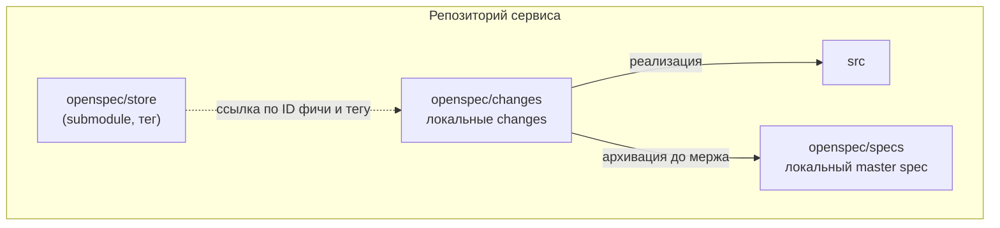

# Подключение Store к кодовым репозиториям

В каждом репозитории сервиса (backend, frontend) есть свой OpenSpec: подключённый Store, локальная схема, локальный master spec и локальные changes.

## Структура репозитория сервиса

```
service/
├── openspec/
│   ├── store/                 git submodule: Store, пин на тег
│   ├── schemas/               локальная схема (форк superpowers-bridge)
│   ├── specs/                 локальный master spec: реализация и поведение этой части
│   └── changes/
│       ├── <суффикс-change>/  артефакты одного change
│       └── archive/           архив завершённых changes
├── hooks/                     pre-push хук (подключается при сборке)
└── src/...
```



## Submodule и пин на тег

Store физически лежит внутри проекта, а не где-то на машине разработчика. Подключение и пин выполняет разработчик, аналитик с git submodule не сталкивается.

```bash
git submodule add <адрес-store> openspec/store
git -C openspec/store checkout PROJ-1234/v1     # фича в работе
git -C openspec/store checkout 2.4.0            # после архивации
```

Submodule **всегда пинится на тег**: не на коммит и не на ветку. При необходимости Store регистрируется в CLI OpenSpec по относительному пути: `openspec store register ./openspec/store --id <id>`.

| Когда | На какой тег |
|---|---|
| фича в работе (в `changes/`) | тег фичи `PROJ-1234/vN` |
| фича архивирована | тег релиза Store `x.y.z` |

## Локальная схема

За основу берётся схема **superpowers-bridge** (репозиторий `JiangWay/openspec-schemas`): brainstorm → proposal → design → specs → tasks → plan → verify → retrospective. Копия хранится в `openspec/schemas/`. Разработчики вправе менять набор артефактов, у backend и frontend он может различаться, и это не регламентируется.

Единственное обязательное дополнение схемы: шаги `brainstorm` и `design` содержат указание прочитать инструкцию своей части в `openspec/store/docs/` (матрицу чтения) на пинованном теге.

Схема требует плагин Superpowers и агента с поддержкой субагентов.

## Метаданные локального change

В начале `proposal.md` каждого change:

```yaml
---
jira-id: PROJ-1234
store-feature: PROJ-1234
store-version: PROJ-1234/v1
---
```

| Поле | Обязательно | Смысл |
|---|---|---|
| `jira-id` | всегда | задача трекера, под которую делается работа |
| `store-feature` | если есть фича в Store | ID фичи Store |
| `store-version` | если есть фича в Store | тег Store, на который пинован submodule |

Ссылка указывает на **фичу в конкретной версии**, а не на путь к папке. Путь после архивации меняется (из `changes/` в `specs/`), поэтому агент и скрипты вычисляют его по ID и версии.

## Именование

| Что | Правило | Пример |
|---|---|---|
| Папка change | читаемый суффикс, без ID задачи | `request-filters-api` |
| Ветка | gitflow-имя и ID задачи | `feature/PROJ-1234` |
| Ветка исправления | `fix/` и ID задачи | `fix/PROJ-5678` |

## Декомпозиция фичи на changes

Декомпозиция нужна, чтобы сузить контекст агента и реализовывать фичу поэтапно.

- Несколько changes одной задачи делаются **в одной ветке** и идут одним PR. У всех одинаковый `jira-id`.
- Если декомпозиция сделана на уровне трекера (отдельные задачи), у каждой задачи своя ветка и свой `jira-id`. `store-feature` у всех один.

## Локальный master spec и архивация

Master spec сервиса описывает техническую реализацию и общее поведение своей части. Когда change завершён и проверен, разработчик архивирует его **в той же ветке до мержа PR**. Если changes несколько, каждый архивируется сразу после завершения. Так код и спецификация в основной ветке всегда согласованы.

## Матрица чтения и поведение агента

Матрица (какие файлы Store читает агент backend и frontend) хранится в инструкциях Store (`docs/`), одна копия на все команды, версионируется вместе с Store. Это поведение **по умолчанию**: разработчик вправе прямым промптом расширить чтение (в том числе на БТ), запретов нет.

| Файл Store | Backend | Frontend |
|---|---|---|
| `FRD.md` | да | да |
| `BFRD.md` | да | нет |
| `FFRD.md` | нет | да |
| `contracts/api.yaml` | да | да |
| `contracts/data-model.yml` | да | нет |
| `contracts/integrations.*` | да | нет |
| master spec модулей из `FRD.md` | да | да |
| БТ | по запросу | по запросу |

Проверки соответствия: [[OpenSpec/gates/Контроль соответствия]].
