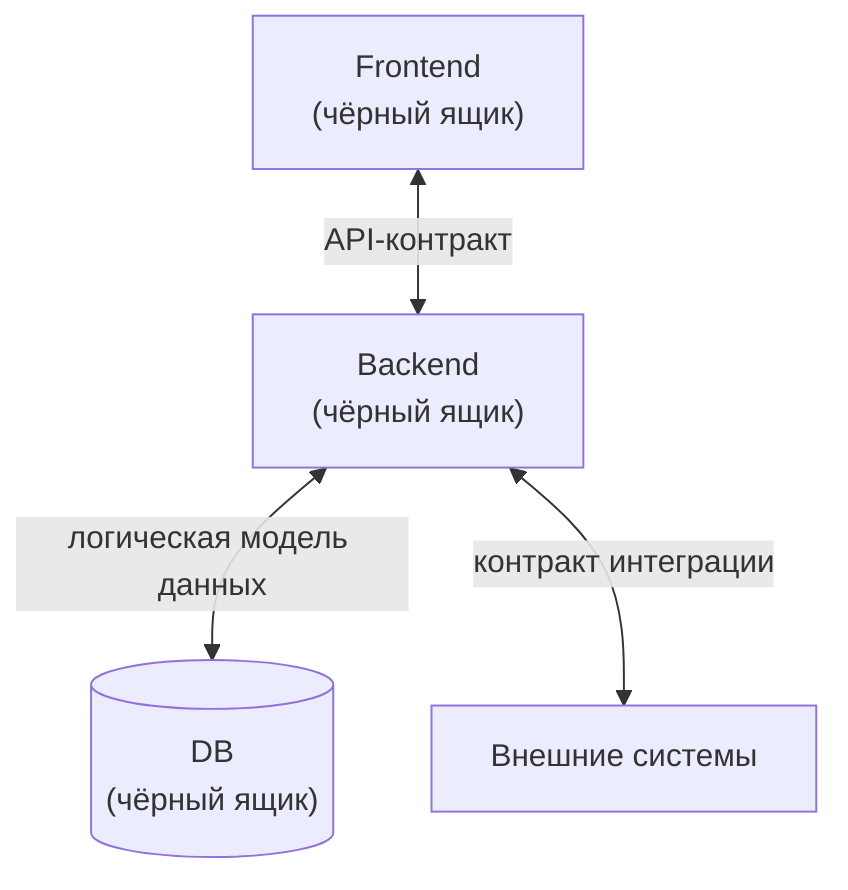

# Принципы Store и чёрный ящик

**Store** — общий репозиторий функциональных требований (ФТ), из которого разработчики в разных репозиториях получают описание того, что нужно реализовать. Документ описывает общие принципы подхода независимо от конкретной команды и стека. Конкретная реализация показана в [[OpenSpec/cases/Sber/README|кейсе Sber]].

## Принцип чёрного ящика

Для аналитика frontend, backend и база данных — чёрные ящики. Он знает, **что они принимают и отдают**, но не знает, **как они устроены внутри**.

Аналитик описывает **стрелки** (взаимодействие), разработчик отвечает за **содержимое блоков** (реализацию).

| Аналитик пишет | Аналитик не пишет |
|---|---|
| ФТ фичи: идея, основной механизм, сценарии | классы, пакеты, компоненты, хуки |
| изменения API-контрактов | выбор СУБД, SQL под конкретную СУБД |
| изменения модели данных в общем виде (сущности, поля, связи, индексы) | кэш, очереди, внутренние сервисы |
| изменения интерфейса: экраны, состояния, поведение | вёрстку и устройство компонентов |
| взаимодействие с внешними системами | как именно оно реализовано |

## Две спецификации

| | Store | Master spec кодового репозитория |
|---|---|---|
| Кто ведёт | системные аналитики | разработчики своей части |
| Вопрос | что и как взаимодействует | как реализовано и как ведёт себя эта часть |
| Содержание | подробные ФТ, контракты, взаимодействие, интеграции | техническая реализация и общее поведение части |
| Где лежит | общий репозиторий Store | в репозитории сервиса |

Спецификации не дублируют друг друга: первая описывает ожидания снаружи, вторая устройство внутри.

## Сквозные принципы

1. **Один источник правды по ФТ.** Требования лежат только в Store, в кодовых репозиториях на них ссылаются, а не копируют.
2. **Версия вместо копии.** Store физически лежит внутри кодового репозитория (git submodule) и всегда пинится на тег.
3. **Минимальный контекст.** Файлы разделены по областям, чтобы агент по умолчанию читал только нужное.
4. **Документация не обгоняет реальность.** Master spec Store описывает только реализованное. Согласованное, но не реализованное лежит в `changes/`.
5. **Проверяем механически то, что можно проверить механически.** Жёстко проверяется контракт взаимодействия, остальное остаётся на разработчиках и ревью.
6. **Простота для аналитиков.** Работа с git сведена к PR и одной ручной операции (тег релиза).
7. **Версии независимы.** Версия Store и версии приложений не связаны, связь односторонняя: сборка фиксирует версию Store, на которую опирается.
8. **Привязка к трекеру.** Любая работа в кодовом репозитории привязана к задаче трекера, даже если фичи в Store нет.

## Где что описано

| Тема | Документ |
|---|---|
| структура Store и артефакты фичи | [[Структура Store и артефакты фичи]] |
| теги и версии | [[Версионирование и теги Store]] |
| подключение к кодовым репозиториям | [[Подключение Store к кодовым репозиториям]] |
| архивация и релиз Store | [[Архивация и релиз Store]] |
| роли | [[OpenSpec/roles/Общие положения]] |
| граничные случаи и проверки | [[OpenSpec/gates/Общие положения]] |
