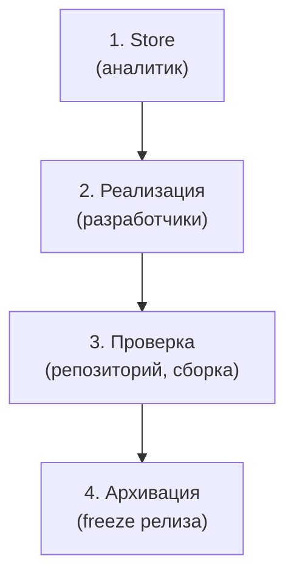

Для лучшего понимания механизма работы, будет приведен пример реализации абстрактной фичи затрагивающей backend и frontend. Конкретная реализация: [[04-Жизненный-цикл-фичи|жизненный цикл фичи в кейсе Sber]].

### Этап 1. Исследование и проектирование в Store (Аналитик)
Работа над задачей начинается исключительно в репозитории Store, еще до появления кода в сервисах
1. Исследование идеи: brainstorm с агентом на основе master spec Store, архива и БТ
2. Описание фичи в папке `changes/PROJ-1234-суффикс/`: `FRD.md`, `BFRD.md`, `FFRD.md`, `contracts/`
3. PR из ветки `feature/PROJ-1234` и командное ревью: коллега-аналитик и по одному представителю затронутых частей
4. После мержа CI автоматически ставит тег фичи `PROJ-1234/v1`

> [!TIP] **Важное правило защиты от дрифта** 
> PR с новой фичей мержится в ветку `master` репозитория Store, но фича **остаётся в каталоге `changes/`** и **не архивируется** в `specs/` до feature freeze релиза, в котором она реализована. Master spec описывает только реализованное.

### Этап 2. Локальная реализация (Разработчики)
Один общий набор требований из Store нельзя автоматически распределить по разным кодовым проектам, поэтому применяется **двухуровневая модель спецификаций**.
1. Подключение Store как git submodule (`openspec/store`) и пин на тег фичи
2. Создание локальных changes по схеме superpowers-bridge. Фичу можно декомпозировать на несколько changes: одна ветка, один PR. В метаданных `proposal.md`: `jira-id` (всегда), `store-feature`, `store-version`
3. Реализация вместе с агентом. Агент по умолчанию читает файлы своей части по матрице чтения из `docs/` Store

> [!CAUTION] Двухуровневая модель
> Кодовый репозиторий имеет собственный независимый корень OpenSpec. В Store лежат требования («что и как взаимодействует», контракты) в чёрном ящике, а в локальном `openspec/specs/` накапливается архитектурная память сервиса («как устроен наш код»).

### Этап 3. Проверка соответствия
Проверки в основном выполняются в репозитории в ходе работы:
1. Pre-push хук: формальные признаки change (блокирует ошибки формата, предупреждает об оформлении)
2. Отчёт `verify`, приложенный к PR
3. Сборка (Jenkins): codegen по API-контракту Store. Единственная автоматическая проверка соответствия

### Этап 4. Финализация и актуализация единого источника правды (Archive)
Когда реализация в коде завершена, протестирована, спецификация должна зафиксировать новое состояние системы
1. **Локальная архивация в сервисе.** Разработчик архивирует change в локальный master spec в той же ветке, до мержа PR
2. **Архивация в Store на feature freeze.** Аналитик создаёт ветку `release/x.y.z`, для каждой реализованной фичи запускает `store-archive`, проводит один PR через ревью и после мержа вручную ставит тег релиза Store `x.y.z`. Архивируются фичи, у которых закрыты все задачи BE и FE в релизе, остальные остаются в `changes/`
3. **Переход разработчиков.** При ближайшей работе разработчики перепинивают submodule на тег релиза

> [!INFO] Версионирование документации (OpenSpec store)
> В Store два вида тегов: тег фичи `PROJ-1234/vN` (ставит CI при мерже, для работы во время разработки) и тег релиза Store `x.y.z` по SemVer (ставит аналитик на freeze). Кодовые репозитории никогда не должны смотреть в плавающую ветку `master` Store: это ломает сборки и приводит к галлюцинациям AI-агентов. Спецификация и приложение имеют **независимые** версии, при этом сборка сервиса фиксирует, на какую версию Store она опирается (пин submodule).
