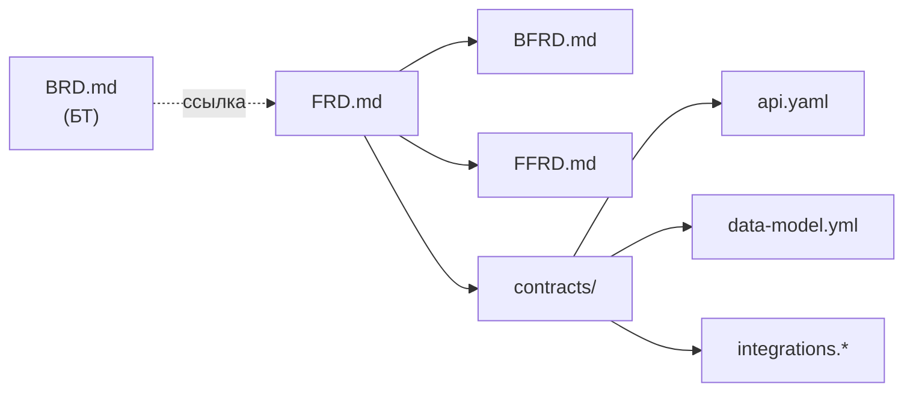

# Структура Store и артефакты фичи

## Структура репозитория

```
store/
├── docs/                        инструкции: принципы, встраивание, матрицы чтения
├── business-requirements/       БТ, скопированные из системы бизнес-требований (BRD-*.md)
├── changes/                     фичи в работе
│   ├── <ID задачи>-<суффикс>/   одна папка на фичу
│   └── archive/                 архив завершённых фич
└── specs/                       актуальное описание системы по модулям
    └── <модуль>/
```

`changes/` содержит согласованное, но ещё не реализованное. `specs/` содержит реализованное и вошедшее в релиз.

## Структура одной фичи

Папка называется по ID задачи трекера и читаемому суффиксу, например `PROJ-1234-request-filters`.

```
changes/PROJ-1234-request-filters/
├── FRD.md          единое ФТ: таблица, идея, механизм, ссылки на BFRD и FFRD
├── BFRD.md         изменения для backend (если затрагивается)
├── FFRD.md         изменения для frontend, включая интерфейс (если затрагивается)
└── contracts/      все не-md файлы
    ├── api.yaml
    ├── data-model.yml
    └── integrations.*
```

**Правило:** нет области, нет файла. Если frontend не затрагивается, файла `FFRD.md` нет.



## Файлы и форматы

| Файл | Формат | Содержание | Читают по умолчанию |
|---|---|---|---|
| `FRD.md` | Markdown | таблица, идея, основной механизм без реализации, ссылки на `BFRD.md` и `FFRD.md` | все |
| `BFRD.md` | Markdown | требования и поведение для backend | backend |
| `FFRD.md` | Markdown | требования, экраны, состояния, поведение интерфейса | frontend |
| `contracts/api.yaml` | OpenAPI (YAML) | фрагмент контракта | backend, frontend |
| `contracts/data-model.yml` | YAML | дельта логической модели данных | backend |
| `contracts/integrations.*` | OpenAPI, AsyncAPI и др. | контракты внешних систем | backend |

Структурированные данные хранятся в машиночитаемых форматах (YAML), текст в Markdown. Если рациональнее другой формат, он допустим.

### Таблица в начале `FRD.md`

Отдельного файла-паспорта нет: короткое определение фичи это таблица в начале `FRD.md`.

| Поле | Пример |
|---|---|
| Jira (ID задачи) | PROJ-1234 |
| Название | Фильтры в списке заявок |
| Тип | feature или fix |
| БТ | ссылка на `business-requirements/BRD-….md` |
| Модули | requests |
| Части | backend, frontend |
| Impact | major, minor или patch |

Жёсткий шаблон ФТ (структура разделов `FRD.md`, `BFRD.md`, `FFRD.md`) нужен для единообразия. Он формируется по результатам практики.

### Формат `api.yaml`: фрагмент OpenAPI

Содержит только добавленные и изменённые пути и схемы. Изменённая операция описывается целиком. Удаляемое перечисляется в поле `x-removed`.

```yaml
openapi: 3.0.3
info:
  title: Requests API (фрагмент фичи PROJ-1234)
  version: fragment
x-removed:
  - path: /requests/legacy-search
    method: get
paths:
  /requests:
    get:
      summary: Список заявок с фильтрами
      # ... операция описана целиком
```

Полный контракт для разработки собирается из `specs/` на пинованном теге плюс фрагмент фичи. У OpenAPI нет формата дельты, фрагмент выбран потому, что параллельные фичи не перезаписывают друг друга при архивации.

### Формат `data-model.yml`: дельта логической модели

Описание в общем виде, без привязки к СУБД: сущности, поля, типы, связи, ограничения, индексы. Дельта группируется по сущностям и действиям.

```yaml
entities:
  Request:
    added:
      indexes:
        - fields: [status, createdAt]
          reason: фильтрация по статусу и периоду
    modified: {}
    removed: {}
```

Миграцию под свою СУБД пишет разработчик.

## Бизнес-требования

БТ ведутся во внешней системе (например, Confluence). Пока они дублируются в папку `business-requirements/` Store, и каждая фича обязана ссылаться на свои БТ в таблице `FRD.md`.

## Master spec по модулям

`specs/` организован по модулям системы. Структура модуля повторяет структуру фичи:

```
specs/<модуль>/
├── FRD.md
├── BFRD.md
├── FFRD.md
└── contracts/
    ├── api.yaml           полный актуальный контракт модуля
    └── data-model.yml     полная актуальная модель модуля
```

Набор модулей определяет команда при внедрении. Фича в таблице `FRD.md` указывает, какие модули затрагивает.

## Схема OpenSpec для Store

В Store используется собственная схема OpenSpec с описанным набором артефактов. Артефактов реализации (`design`, `plan`, `verify` и других) в ней нет: это зона разработчиков. Инструкции схемы задают агенту, что писать в каждом файле и чего не писать.

Начальное наполнение Store при внедрении: существующие контракты и модель данных импортируются в `specs/`, существующие ФТ переносятся в новый формат по возможности с разделением на части, а описание поведения накапливается постепенно по мере архивации фич.

См. также [[Архивация и релиз Store]] и [[Версионирование и теги Store]].
